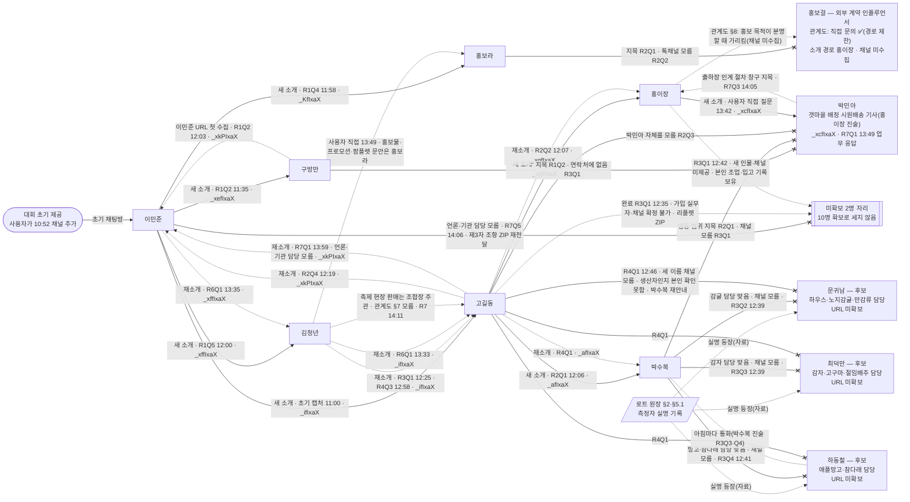
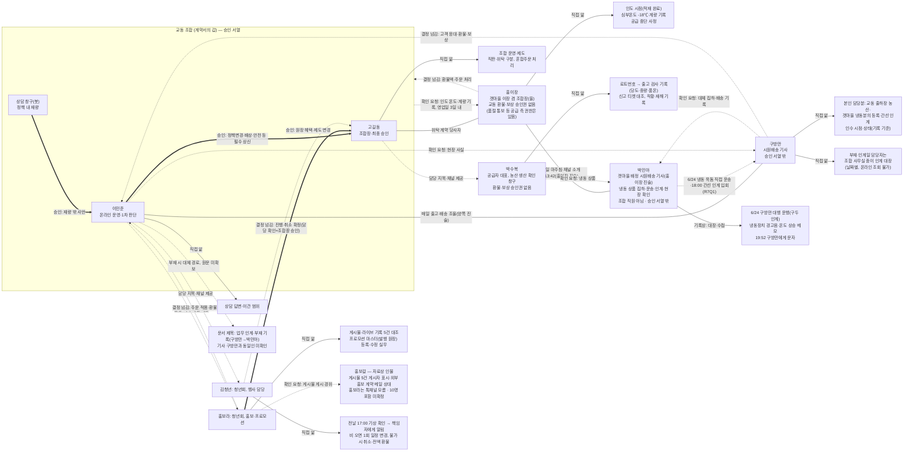

# 담당자 지식 지도 — 누가 무엇을 알고, 무엇을 정하나

**현재 기준 14:42 KST (root 최종 숫자):** 직접 업무 응답 **9명**, 미확보 1명. 감독 문답 **72건**. 구조화 지식 **266건**(runtime 255 + 초기 11), 원본 **29개**. 사용자 직접 문답(외부 일반 질문)은 [별도 보존](../interviews/sources/external-observed-messages.json)한다. 아래 본문의 시각별 숫자(8명·68건·238건 등)는 그때 기록이다. 자료 처음 읽은 시각은 11:46 KST다. 대회 속 기준일은 2037-06-30이다(현실 날짜와 구분).

**읽는 법.** 어떤 사실을 **아는 사람**과 그 사실로 **결정하는 사람**은 다르다. 같은 사건이라도 현장 사실(온도·배송 경과)과 정책 판단(환불·예외)은 다른 사람에게 묻는다. 이 문서는 ① 내부 역할 지도와 ② 고객에게 안내할 수 있는 범위를 나눠 적는다.

출처(클릭 가능): **위임표** = 권한 위임표 [p1](../interviews/sources/B10-01.png) · [p2](../interviews/sources/B10-02.png) · [p3](../interviews/sources/B10-03.png) · [p4](../interviews/sources/B10-04.png) · [p5](../interviews/sources/B10-05.png) · **계약서** = 수산물 위탁 판매 계약서 [추출본](../interviews/sources/위탁계약서-추출.txt) · [원본 PDF](../interviews/sources/VPaqTY6ACayEeUct0aT6aw.pdf) · **민준Q2** 같은 표기 = 인물별 질문 번호: [이민준](../interviews/이민준.md) · [고길동](../interviews/고길동.md) · [홍이장](../interviews/홍이장.md) · [구방만](../interviews/구방만.md) · [원문 JSON](../interviews/sources/round1-transcript.json) · [정리된 지식](../interviews/knowledge.json). 표 안의 출처 표기도 각 원문으로 연결된다.

**세컨드 브레인 안에서 이 문서의 위치:** ① 원본 색인([자료목록](자료목록.md), 자료 담당 작성) → ② 검증된 사실·조건·예외(각 원문) → **③ 인물 관계(이 문서)** → ④ 에이전트 입력. 이 문서의 사실 한 줄마다 원문 링크를 단다. 링크가 없거나 「미확인」이 붙은 내용은 사실로 쓰지 않는다. 인계 자료 원본: [인계 대장](../대화자료/Q4owkAQyT-xhxfMKTJ2wUw/C31_handover-ledger.png) · [수첩](../대화자료/Q4owkAQyT-xhxfMKTJ2wUw/C31_driver-notebook.png) · [판독본](../research/handover-notes.md)(사용자 보관본 `대화자료/` 폴더).

---

## 0. 연락처 획득 경로 — 누가 누구를 소개했나 (12:51 KST 기준)

원문: [1차 JSON](../interviews/sources/round1-transcript.json) · [2차 JSON](../interviews/sources/round2-transcript.json) · [3차 JSON](../interviews/sources/round3-transcript.json) · [이민준 초기 캡처(10:52~11:00)](../interviews/sources/이민준-기존캡처.png) · [고길동 초기 캡처(11:04~11:05)](../interviews/sources/고길동-기존캡처.png). 표의 "R2Q1" 같은 표기는 해당 라운드 JSON 안의 인물별 질문 번호다.

**읽는 법**
- 실선 `-->`는 **새 소개**로, 그 사람의 채널을 처음 받은 경로다.
- 점선 `-.->`는 **재소개**로, 이미 받은 채널을 다른 사람이 다시 준 경우다.
- `--x`는 **이름만 지목됐고 채널을 받지 못한 경로**다.
- 굵은 테두리의 "남은 화살표"가 앞으로 물어볼 곳이다. 이름이 등장했다고 해서 10명 포함이나 접근 가능을 확정하지 않는다.

### 연락처별 획득 표 — 인터뷰 가능 10명 기준

| 사람 | 제공자 → 소개 | 실제 업무 관계(원문) | 최초 채널 제공 | 중복 제공(재소개) | 접근 / 업무 응답 | 모른다고 한 범위 | 다음 확인 경로 |
|---|---|---|---|---|---|---|---|
| 이민준 | 대회 초기 제공(사용자가 10:52 채널 추가) | 구방만: "조합몰 온라인 운영자이고, 저와 매일 출고·배송을 조율"([R1Q2](../interviews/sources/round1-transcript.json)). 고길동: "외손자 이민준… 온라인 판매·상담·정산 실무"([R2Q4](../interviews/sources/round2-transcript.json)) | 채팅 접근은 초기부터 있었다. URL `_xkPIxaX`는 구방만 R1Q2(12:03)에서 처음 수집했다 | 고길동 R2Q4 12:19 | 접근 ✓ / 응답 ✓ | 조합원 가입·등록 확인 담당([R3Q1](../interviews/sources/round3-transcript.json)). API 명세 원문은 이 채널로 못 준다(R1Q3) | 과거 약속(78자)은 R3Q2로 완료됐다. 연락처 경로는 없다 |
| 고길동 | 이민준 → 고길동 | 이민준: "최종 승인권자인 고길동 조합장님… 가족이라고 해서 승인 절차가 가벼워지는 건 아니"([초기 캡처](../interviews/sources/이민준-기존캡처.png) 11:00). 김청년: 행사 승인 사안을 보고하는 조합장([R3Q1](../interviews/sources/round3-transcript.json)) | 이민준 초기 캡처 11:00, `_ifIxaX` | 김청년 R3Q1 12:25, R4Q3 12:58 | ✓ / ✓ | 갯마을 실제 계량 담당 이름([R2Q2](../interviews/sources/round2-transcript.json)). 박민아, 6/24 운행자, 구방만 채널([R2Q3](../interviews/sources/round2-transcript.json)) | 가입·출자·탈퇴 질문은 완료됐다([고길동 R3Q1](../interviews/sources/round3-transcript.json)). 조합원 제도(가입 조건·혜택·등급·탈퇴)는 본인 범위이고 리플렛을 가지고 있다. 인쇄물 문안 제작은 홍보라다. 출자 세부는 리플렛에 없다. 가입 실무 담당자와 채널은 "확정해 드릴 수 없"다고 했다 |
| 홍이장 | 고길동 → 홍이장 | "갯마을 이장 겸 조합장… 조합 대 조합으로 위탁 공급을 협의하고 갯마을 현장 사정을 확인하는 상대"([R1Q2](../interviews/sources/round1-transcript.json)). 위탁계약 을 대표 | 고길동 R1Q2 11:33, `_xgfIxaX` | 고길동 R2Q2 12:07(계량 담당을 묻자 재지목) | ✓ / ✓ | 환불액과 주문 처리는 교동이 정한다. 온도·인도 시점과 무게 기준까지만 말한다. 이번 고객이 언제 받을지 날짜는 못 박지 못한다({H1}) | 조업·입고 실무자를 따로 물었으나 새 이름·채널은 주지 않고 본인 기록(xlsx)을 줬다. 별도 실무자가 없다고 말한 것은 아니다. 결항 뒤 집하·간선 재개는 구방만, 농산 작황은 박수복으로 재지목했다. 구방만 연락 창구는 자기 자료에 없다([홍이장 R3Q1](../interviews/sources/round3-transcript.json)) |
| 구방만 | 이민준 → 구방만 | "교동마을 집하·출고·배송을 맡은 시원배송 기사님이고, 나랑 매일 출고·배송을 조율"([R1Q2](../interviews/sources/round1-transcript.json)) | 이민준 R1Q2 11:35, `_xefIxaX` | 없음(고길동은 채널이 없다고 함, R2Q3) | ✓ / ✓ | 본인 담당분 밖, 박민아 채널(연락처에 없음, [R3Q1](../interviews/sources/round3-transcript.json)) | 없음 |
| 홍보라 | 이민준 → 홍보라 | "함께 일하는 청년회 동료고, 홍보·프로모션을 맡고 있어"([R1Q4](../interviews/sources/round1-transcript.json)) | 이민준 R1Q4 11:58, `_KfIxaX`. 이름은 초기 캡처 11:00과 R1Q1에서 먼저 나왔다 | 없음 | ✓ / ✓ | 홍보걸 톡채널(외부 홍보 계약으로 메일만 주고받음, [R2Q2](../interviews/sources/round2-transcript.json)) | 홍보걸은 톡 경로가 아니라 메일 기록 기준으로 하라고 했다. 홍보라에게 다시 묻지 않는다 |
| 김청년 | 이민준 → 김청년 | "청년회 동료이고, 농촌 체험·견학·단체 행사의 접수와 운영을 같이 조율하는 행사 담당"([R1Q5](../interviews/sources/round1-transcript.json)) | 이민준 R1Q5 12:00, `_xffIxaX`. 이름은 초기 캡처 11:00과 R1Q1에서 먼저 나왔다 | 없음 | ✓ / ✓ | 체험 책임자·담당의 이름([R3Q1](../interviews/sources/round3-transcript.json)) | 고길동을 안내받았다(이미 확보) |
| 박수복 | 고길동 → 박수복 | "오랫동안 교류해 온 공급자 대표… 생산 상태와 현장 기록을 확인하는 창구… 다른 생산자에게 확인할 내용도 물어볼 수 있소… 환불이나 보상을 승인하는 사람은 아니"([R2Q1](../interviews/sources/round2-transcript.json)) | 고길동 R2Q1 12:06, `_afIxaX` | 없음 | ✓ / ✓ | 문귀남·최덕만·하동철 채널, 다른 생산자의 검사·생산 상황(직접 본 게 아님). 박민아 채널, 냉동 상품 출고 검사·로트 기록([R3Q1](../interviews/sources/round3-transcript.json)) | 생산자 3명의 소관은 직접 확인했지만 채널은 모른다([박수복 R3Q2](../interviews/sources/round3-transcript.json)·[박수복 R3Q3](../interviews/sources/round3-transcript.json)·[박수복 R3Q4](../interviews/sources/round3-transcript.json)). 다른 생산자 밭 일은 "들은 대로만 옮기고 직접 본 것처럼 말하지 않"는 조건으로 물어봐 줄 수 있다고 했다. 채널은 고길동에게 먼저 물으라고 권했다 |
| 박민아 | 홍이장 → 박민아(사용자 직접 질문 13:42, [원문](../interviews/sources/external-observed-messages.json)) | 홍이장: "갯마을에서 냉동 상품을 집하하고 운송하고 인계하는 일은 박민아 기사가 해요. 갯마을에 배정된 시원배송 기사이고, 현장 확인도 같이 해요. 조합 직원은 아니에요. 매일 마주쳐서 안면이 있고". 인계 대장: 5/20 박민아 정담당(사유 '시원배송 정기교육', 대행 구방만), 6/24 구방만 부재·대행 박민아([C31 대장](../대화자료/Q4owkAQyT-xhxfMKTJ2wUw/C31_handover-ledger.png)) | 홍이장 13:42, `_xcfIxaX`. 사용자가 13:43 추가했다 | 없음(이전 경로 구방만·박수복·고길동은 모두 채널 모름) | ✓ / ✓ ([R7Q1](../interviews/sources/round7-transcript.json) 13:49) | 구간별 온도 수치(기억으로 말하지 않음, 차량 기록계 로그로 확인해야 함) | 기록계 로그(URL 미제공) |
| (미확보 2명) | — | — | — | — | — | — | 아래 후보 3명의 결과와 「조직 관계도(조합·갯마을·택배사·인플루언서)」 §7(과거 행사 목록에서 제목만 확인, 미확보)을 본다. 그 밖의 이름은 추측하지 않는다 |

### 남은 3명 탐색 우선순위 (12:51 기준)

> **13:51:** 박민아 확보로 남은 자리는 **2명**이다. 아래 표는 12:51 판단을 보존한 것이다. 새 단서로 「조직 관계도」 §7(제목만), 이름 없는 역할(체험 '담당 확인', 정기배송 담당, 언론·기관 문의 담당 — R7 고길동 질문 진행 중)이 있다.

남은 3명이 갯마을, 생산자, 조합 직원 중 어느 쪽인지 정하는 원문 근거는 없다. 아래는 근거가 강한 순서로 정한 **탐색 순서**다. 역할만으로 사람을 만들거나 숫자 3을 맞추지 않는다.

| 순위 | 경로 | 근거 | 현재 상태 | 한계 |
|---|---|---|---|---|
| 1 | 박수복 → 고길동 경유 **품목 생산자** | 원장 §5.1 측정자 실명 3개. 박수복이 소관을 직접 확인했다: 문귀남은 하우스·노지감귤·만감류, 최덕만은 감자·고구마·절임배추, 하동철은 애플망고·참다래. 박수복 본인은 수박·멜론이다([박수복 R3Q3](../interviews/sources/round3-transcript.json)·[박수복 R3Q4](../interviews/sources/round3-transcript.json)) | 박수복 → 고길동 → 박수복으로 돌아와 **연락처 경로 종결**. 고길동은 세 이름의 채널을 모르고, 생산자인지도 본인이 확인할 수 없다며 박수복을 다시 안내했다([고길동 R4Q1](../interviews/sources/round4-transcript.json)). 인물이 없다거나 인터뷰가 불가능하다고 확정한 것은 아니다. 품질 확인은 박수복의 전달 제안(간접 증언)으로 받을 수 있다 | 역할은 확인됐지만 URL이 없다. 인터뷰 가능 대상인지, 남은 3명과 같은 사람인지는 근거가 없다 |
| 2 | 홍이장 경유 **갯마을 조업·계량 실무** | 고길동은 갯마을 실제 계량 담당 이름을 모른다(R2Q2). 계약서는 계량·조업·입고 기록을 갯마을(을)이 작성한다고 정한다 | **완료. 새 인물·채널 미제공.** 홍이장이 조업·입고 기록을 본인이 갖고 있다며 xlsx(MatemuULfW2nG1dnufufsA)를 줬다. 구방만·박수복을 다시 지목했다([홍이장 R3Q1](../interviews/sources/round3-transcript.json)) | 갯마을 쪽 다른 실무자가 있는지 없는지는 원문에 없다. 있다고도 없다고도 쓰지 않는다 |
| 3 | 고길동 경유 **조합 가입·출자 실무** | 원장 DANGOL5·REFER5000은 대상을 "조합원"으로 정하고 「외부 조합원 규정집」을 인용한다. 고길동은 제도는 알지만 가입 실무자와 채널은 확정하지 못했다([고길동 R3Q1](../interviews/sources/round3-transcript.json)) | 질문 완료(실무자 미확정). 리플렛 판독 결과 **자료에 새 조합 직원 실명이 나오지 않음**. HTML에는 온라인 판매·고객상담 담당으로 이민준만 적혀 있다([membership-notes](../research/membership-notes.md)) | 새 인물이 있다는 근거도, 없다는 근거도 없다. 만들지 않는다 |

### 자료에서 실명이 확인된 생산자 후보 3명 — URL 미확보, 10명 확보로 세지 않음

근거는 [로트 원장](../research/lot-crop/extracted/로트원장.html)이다. 판독본은 [lot-crop-notes](../research/lot-crop-notes.md)이고, 감독이 행을 직접 대조했다.
- §2는 당도·중량·등급을 아는 사람을 "해당 품목 생산자"로 정한다. 문의 창구는 "박수복(공급자 대표 — 타 생산자 건은 물어 전달)"이다.
- §5.1의 측정자 칸에 아래 실명이 있다. 원장은 측정자의 연락처·주소를 적지 않는다(제3자 정보 보호 조항).
- 측정자를 해당 품목 생산자로 읽는 것은 §2와 §5.1을 합친 해석이다.

| 후보 | 원장상 품목·로트 예 | 연결 근거 | 채널 질문 | 상태 |
|---|---|---|---|---|
| 문귀남 | 하우스감귤(HGL). KD-HGL-370624-01, -370626-02, -370629-01 등 | §5.1 측정자. 고길동이 박수복을 "다른 생산자에게 확인할 내용도 물어볼 수 있"는 창구로 소개했다(R2Q1). 박수복이 "감귤을 맡으신 분이 맞습니다"라고 확인했다([박수복 R3Q2](../interviews/sources/round3-transcript.json)) | 박수복 82자: **완료.** 채널은 모르고, 당도·검사 범위도 대신 말할 수 없으니 고길동에게 먼저 물으라고 했다([박수복 R3Q2](../interviews/sources/round3-transcript.json)) | **역할 확인(박수복 진술), URL 미확보.** 소관은 하우스·노지감귤·만감류다([박수복 R3Q3](../interviews/sources/round3-transcript.json)). 고길동도 채널을 모름([고길동 R4Q1](../interviews/sources/round4-transcript.json)). 연락처 경로 종결 |
| 최덕만 | 봄감자(PTT). KD-PTT-370622-01, -370619-01 등 | §5.1 측정자. 박수복이 "감자는 최덕만 씨가 맡는 품목", 감자·고구마·절임배추 담당이라고 확인했다([박수복 R3Q3](../interviews/sources/round3-transcript.json)) | 박수복 79자: **완료, 채널 모름.** 고길동을 권고했다 | **역할 확인(박수복 진술), URL 미확보.** 고길동도 채널을 모르고 생산자 여부를 확인하지 못함([고길동 R4Q1](../interviews/sources/round4-transcript.json)). 연락처 경로 종결 |
| 하동철 | 애플망고(MNG). KD-MNG-370601-01, -370605-01 등 | §5.1 측정자. 박수복이 애플망고·참다래 담당이라고 확인했다. 박수복과 "아침마다 통화를 하는 편"이다([박수복 R3Q4](../interviews/sources/round3-transcript.json)) | 박수복 76자: **완료, 채널 모름.** 고길동을 권고했다 | **역할 확인(박수복 진술), URL 미확보.** 고길동도 채널을 모르고 생산자 여부를 확인하지 못함([고길동 R4Q1](../interviews/sources/round4-transcript.json)). 연락처 경로 종결 |

**간접 증언 경로:** 박수복은 다른 생산자 밭 일을 물어봐 줄 수 있다고 했다. 다만 "들은 대로만 옮기고 직접 본 것처럼 말하지 않"겠다고 했다(R3Q3·Q4). 이렇게 받은 내용은 **간접 증언**으로 표시해 쓰고, 박수복이 직접 본 사실(수박·멜론, 로트 기록 조회)과 섞지 않는다. 고길동도 R4Q1에서 같은 경로를 안내했다([고길동 R4Q1](../interviews/sources/round4-transcript.json)).

측정자 실명과 로트번호는 내부 대조용이다. 고객 답변에 옮기지 않는다([lot-crop-notes](../research/lot-crop-notes.md) 187행).

### 이름만 등장한 자료상 인물 — 10명에 넣지 않음

| 사람 | 지목한 사람·범위 | 채널 시도와 결과 | 상태 |
|---|---|---|---|
| 홍보걸 | 홍보라가 게시 경위를 안다고 지목했다([R2Q1](../interviews/sources/round2-transcript.json)). 게시물 5건의 게시자 표시도 홍보걸이다([게시물 판독](../research/promo-posters-notes.md)) | 홍보라: "외부 홍보 계약 건으로 메일을 주고받은 사이라서, 톡채널 주소를 알고 있지 않고"([R2Q2](../interviews/sources/round2-transcript.json)) | 채널 미수집. 채널이 없다고 확정하지 않는다. 다른 제공자는 없다 |
| 박민아 **(13:49 직접 인터뷰 가능으로 전환 — 위 획득 표 참조. 아래는 과거 경로 기록)** | 구방만이 대행 집하·배송 기록을 안다고 지목하고 대장·수첩을 제공했다([R1Q2](../interviews/sources/round1-transcript.json)). 박수복이 냉동 상품을 안다고 지목했다([R2Q1](../interviews/sources/round2-transcript.json)) | 고길동은 박민아 자체를 모른다([R2Q3](../interviews/sources/round2-transcript.json)). 박수복은 채널을 모른다([R3Q1](../interviews/sources/round3-transcript.json)). 구방만은 "제 가진 연락처에 없어서"([R3Q1](../interviews/sources/round3-transcript.json), 12:31) | **경로 종결**(감독 기준: 구방만 1회 질문 후 모르면 종결). 채널이 없다고 확정하지 않는다 |

**집계(14:42 최종):** 직접 업무 응답 9명, 감독 문답 72건, 구조화 지식 266건(runtime 255 + 초기 11), 원본 29개. 아래는 14:13 기록이다. **집계(14:13):** 채널 URL 8개, 접근·업무 응답 8명, 업무 답변 원문 64건(1~5차 각 10, 6차 4, 7차 10). 박민아는 기존 소개 경로(구방만·박수복·고길동)가 모두 막힌 뒤 사용자가 홍이장에게 직접 물어 확보했다. 여기에 실명 후보 3명(URL 미확보)이 있다. **아직 10명 확보가 아니다.** 4차 고길동 111자도 완료됐다(채널 모름). 지금 진행 중인 연락처 질문은 없다. 남은 3명의 다음 경로는 미정이다. 생산자 3명을 남은 3명과 같다고 볼 근거는 없다. 고길동 86자는 R3Q1(12:35)로 완료됐다. 이민준 78자는 R3Q2로 완료됐다. 박민아 경로는 구방만 R3Q1로 종결했고 반복하지 않는다.

---

## 1. 관계도

| 선 | 뜻 | 근거 |
|---|---|---|
| `==>` 승인 | 상담 → 이민준 → 고길동. 운영자 건너뛰기 금지, 운영 판단에서 끝나면 조합장까지 안 올림 | [위임표 제10조①~③](../interviews/sources/B10-04.png) (B10-04·05) |
| `-->` 직접 앎 | 본인 답변으로 확인된 지식 또는 문서상 담당 범위(개별 사실 숙지까지 단정하지 않음) | 각 행 출처(아래 표) |
| `-.->` 확인 요청·결정 넘김·미확보 | 다른 사람에게 확인하거나 결정을 넘기는 방향, 원문이 없는 문서 | [민준Q2](../interviews/이민준.md)·Q3, [구방만Q1](../interviews/구방만.md), [계약서 제9조①](../interviews/sources/위탁계약서-추출.txt), [홍이장Q1](../interviews/홍이장.md), [위임표 제10조④](../interviews/sources/B10-05.png) |
| `---` 상호 관계 | 위탁 계약 당사자(갑 대표 고길동 / 을 대표 홍이장 서명), 이민준↔구방만 매일 출고·배송 조율 | [계약서 서명란](../interviews/sources/위탁계약서-추출.txt)(5/5), [고길동Q2](../interviews/고길동.md), [민준Q2](../interviews/이민준.md), [구방만Q1](../interviews/구방만.md) |

그리지 않은 관계(근거 없음): 고길동–박민아(고길동이 모른다고 답함, [고길동R2Q3](../interviews/sources/round2-transcript.json)), 고길동–갯마을 실제 계량 담당([고길동R2Q2](../interviews/sources/round2-transcript.json)), 구방만과 홍이장의 직접 연락, 박민아 노드와 위임표 인계 기록 문서가 같은 문서인지(인계 대장은 판독 완료, 동일 여부는 미확인), 시원배송이 계약서 제12조③의 「택배사」인지, 고길동이 구방만을 아는지.

---

## 2. 인물별 경계 (내부 역할 지도)

아는 범위 ≠ 권한. 각 표의 행은 세 가지를 따로 적는다.

- **승인권 밖**: 알더라도 그 사람이 결정하지 않는 일.
- **권장 확인 경로**: 다른 사람이 더 직접적인 근거를 가진 사실. 그 사람이 전혀 모른다는 뜻이 아니다.
- **직접 근거 없음**: 아직 묻지 않았거나 원문이 없는 것. 모른다는 단정이 아니다.

### 이민준 — 온라인 운영·CS, 1차 판단

| 구분 | 내용 | 근거 |
|---|---|---|
| 직접 확인 가능 | 상담 창구에서 어디까지 답하고 어디서 넘기는지, 규정 밖 예외를 어떻게 올리는지(본인이 질문 예시로 제시). 구방만과 매일 출고·배송 조율 | [민준Q1](../interviews/이민준.md)·Q2 |
| 판단·승인 | 재량 밖 사안의 1차 운영 판단. 운영 판단에서 종결 가능 | [위임표 제10조①②](../interviews/sources/B10-04.png) |
| 승인권 밖 · 권장 확인 경로 | 승인권 밖: 정책·가격·권한 변경, 손해배상·분쟁·법률, 안전·대외 공식 입장은 고길동까지 필수 상신. 권장 확인: 출고·배송 **현장 사실**은 구방만에게 물으라고 본인이 안내 | [민준Q2](../interviews/이민준.md)·Q3, [위임표 제10조③](../interviews/sources/B10-05.png) |
| 연결 상대 | 구방만(채널 제공), 홍보라·김청년(채널 제공), 고길동 | [민준Q1](../interviews/이민준.md)·Q2·[민준Q4](../interviews/sources/round1-transcript.json)·[민준Q5](../interviews/sources/round1-transcript.json) |
| 후속 답(R2·R3) | 무증빙 하자에 대해 "기억으로 말하면 안 된다"며 판매·환불 규정 HTML과 증빙 권위 서열 PDF를 줬다. 규정 밖 예외는 이민준 1차 판단, 재량을 넘으면 고길동 최종 승인이다. 상담 창구의 정확한 처리 범위는 단정하지 않았다([이민준R2Q1](../interviews/sources/round2-transcript.json)). 조합원 가입·등록을 누가 확인하는지는 확실히 모른다며 채널을 주지 않았다([이민준R3Q1](../interviews/sources/round3-transcript.json)) | 같은 행 |
| 과거 약속(R3Q2) | 상담 원장 기록을 먼저 본다. 같은 고객 이력에 두 건이 있다. 06-25 상담: 보상 120,000원 약속 기록이 있으나 이행 내역은 없다. 문면이 "다음 주문에도 무조건 무료배송"이라 **미래 주문 선약속**으로 따로 취급한다. 06-18 상담: "다음 주문 1회 무료배송 적용" 4,000원, 이행 대기 상태이고 상담사 재량 범위 안이면 이행한다. 기록이 있다는 것과 이행해야 한다는 것은 다른 판정이다. 발행 사실이 없다는 판단은 원장·아카이브 조회 결과로 남긴다([이민준R3Q2](../interviews/sources/round3-transcript.json)). 위임표 제7·8조(미래 무조건 약속 불가, 기록 있어도 권한 밖이면 정정)와 함께 읽는다 | 같은 행 |
| 직접 근거 없음 | 운영자 재량의 수치 한도, 부재 시 대체 승인자, 실제 상담 사례 | [위임표 제10조](../interviews/sources/B10-04.png) 불확정, 인계 기록 미확보 |
| 하지 말 것 | 주문 조회 API 명세 요청 — 제공 불가 답변 받음, 반복 금지 | [민준Q3](../interviews/이민준.md) |

### 고길동 — 교동 조합장, 최종 승인·제도

| 구분 | 내용 | 근거 |
|---|---|---|
| 직접 확인 가능 | 조합 운영·제도, 직판(교동)·위탁(갯마을) 구분, 고객 창구 단일, 혼합 주문의 상품별 환불·정산 | [고길동Q2](../interviews/고길동.md), 위임표 제공자 |
| 판단·승인 | 운영자를 거쳐 올라온 사안의 최종 승인. 단 **조건 없는 미래 혜택 약속은 조합장 승인으로도 불가** | [위임표 제7조·제10조](../interviews/sources/B10-03.png) |
| 승인권 밖 · 권장 확인 경로 | 승인권 밖: 조건 없는 미래 혜택 약속(위 행). 권장 확인: 갯마을 공급 사정·위탁 조건은 홍이장(고길동도 계약 당사자이나 개별 조항의 직접 답변은 미확인). 대신 메시지 전달·자리 주선은 약속 안 함 | [고길동Q2](../interviews/고길동.md) |
| 연결 상대 | 홍이장(채널 제공, 갯마을 계량·얼음·물 빠짐 확인 경로로 재지목), 박수복(채널 제공) | [고길동Q2](../interviews/고길동.md), [고길동R2Q1](../interviews/sources/round2-transcript.json), [고길동R2Q2](../interviews/sources/round2-transcript.json) |
| 직접 근거 없음 | 안전·배상 사안에서 무엇을 보고받는지, 실제 승인 회신 경로. **본인이 안다고 답한 것:** 개정 이력을 보유하고 개정을 승인했으므로 구판·개정판을 안다. 운영 창구는 이민준(_xkPIxaX)이다([고길동R2Q4](../interviews/sources/round2-transcript.json)). **본인이 모른다고 답한 것:** 갯마을에서 실제 계량하는 담당의 이름([고길동R2Q2](../interviews/sources/round2-transcript.json)), 박민아의 존재·업무·채널, 6/24 운행자, 구방만 채널([고길동R2Q3](../interviews/sources/round2-transcript.json)). 조합·공급 대표 수준의 연결은 알지만 현장 개인은 모른다 | [고길동Q1](../interviews/고길동.md)(분야만 언급) |

### 홍이장 — 갯마을 이장 겸 조합장, 위탁 공급(을)

| 구분 | 내용 | 근거 |
|---|---|---|
| 직접 확인 가능 | **갯마을에서 넘긴 물건의 인도 시점 온도와 인도 시점까지만.** 인도 = 갯마을 출하장에서 적재 완료. 냉동은 심부온도 -18℃ 이하 확인·기록, 계량 기록, 공급 중단 통보 | [홍이장Q1](../interviews/홍이장.md) 끝문장, [계약서 제2조·제4~6조](../interviews/sources/위탁계약서-추출.txt) |
| 판단·승인 | 교동의 환불액·주문 처리는 **결정하지 않음**. 교동 승인 서열에 없고, 공급 측 확인이 교동 승인을 대신하지 않음. 공급 측 권한은 품절 확정 통보(을 통보로 확정) | [홍이장Q1](../interviews/홍이장.md), [위임표 제10조⑥](../interviews/sources/B10-05.png), [계약서 제6조②·제9조②](../interviews/sources/위탁계약서-추출.txt) |
| 승인권 밖 · 권장 확인 경로 | 승인권 밖: 고객 응대 결론, 환불·보상 정책. 권장 확인: 인도 이후 보관·운송 구간 온도는 교동이 관리하는 콜드체인 로그(본인이 「인도 시점까지만 말할 수 있다」고 함) | [계약서 제5조②·제9조②](../interviews/sources/위탁계약서-추출.txt) |
| 의무 | 교동 요청 시 계량·인도 온도·조업 기록을 영업일 3일 이내 제공. 기한 넘기면 기록 부재로 봄 | [계약서 제9조①③](../interviews/sources/위탁계약서-추출.txt) |
| 연결 상대 | 고길동(계약 상대방) | [계약서 서명란](../interviews/sources/위탁계약서-추출.txt), [고길동Q2](../interviews/고길동.md) |
| 직접 근거 없음 | 갈치·옥돔 라벨(박수복 R4Q1이 홍이장을 지목, 미질문). 인도 시점 온도 원본(5차 승인 76자 진행 예정). (해소됨: 중량 세칙은 [중량 판독](../research/seafood-weight-notes.md)으로 확보, 공급 중단 사례는 [조업·입고 판독](../research/fishing-intake-notes.md)의 06-21 행) | [박수복 R4Q1](../interviews/sources/round4-transcript.json) |

### 구방만 — 시원배송 기사

| 구분 | 내용 | 근거 |
|---|---|---|
| 직접 확인 가능 | 미수령 문의 시 ① 본인이 집하·인계한 물건인지 기록 확인 → ② 넘긴 물건이면 인수 시점과 상태 확인. **기록으로 확인된 위치·완료만** 말함. 과거 운행 기억으로 현재 위치를 확정하지 않음. **본인 담당분까지만 안다**: 교동 출하장을 거치는 농산과 갯마을 냉동분의 등록·간선 인계. 부재·인계일의 대행자는 조합 사무실 종이 인계 대장에 날짜별로 적혀 있고, 온라인으로는 조회되지 않는다 | [구방만Q1](../interviews/구방만.md)·[구방만Q2](../interviews/구방만.md) |
| 판단·승인 | 고객 조치·환불·보상 결정권은 없음. 고객에게 조치 약속, 환불·보상 결정을 하지 않음. 위임표 승인 서열에도 없음. 「외부 협력자」(제10조⑤) 해당 여부는 미확인 | [구방만Q1](../interviews/구방만.md), [민준Q2](../interviews/이민준.md), [위임표 제10조](../interviews/sources/B10-04.png) |
| 승인권 밖 · 권장 확인 경로 | 승인권 밖: 고객 조치 약속, 환불·보상 결정. 권장 확인: 고객 상담·주문은 이민준에게, 대신 집하·배송을 맡은 날의 기록은 박민아에게 확인하라고 본인이 안내 | [구방만Q1](../interviews/구방만.md)·[구방만Q2](../interviews/구방만.md), [민준Q2](../interviews/이민준.md) |
| 연결 상대 | 이민준(Q2에서 채널 https://pf.kakao.com/_xkPIxaX 제공), 박민아(기록 보유자로 지목, 채널은 주지 않음) | [구방만Q2](../interviews/구방만.md) |
| 직접 근거 없음 | 간선 인계 때 **온도를 확인·기록하는지**, 6/24 19:52 박민아 문자(옥돔 확인 부탁, [수첩](../대화자료/Q4owkAQyT-xhxfMKTJ2wUw/C31_driver-notebook.png))를 받은 뒤 무엇을 했는지, 이민준에게 알리는 구체적 방식, 간선 인계받는 쪽이 누구인지, 위임표 인계 기록의 구방만과 동일인인지 | [구방만Q1](../interviews/구방만.md)·[구방만Q2](../interviews/구방만.md) 미언급 |
| 해결된 공백 | ~~수산물 취급 여부~~ → 갯마을 냉동분의 등록·간선 인계를 맡는다. 같은 질문을 다시 하지 않는다 | [구방만Q2](../interviews/구방만.md) |

### 추가로 업무 답변을 받은 인물(홍보라·김청년·박수복)과 자료상 인물

- **홍보라 (업무 직접 답변, [홍보라R2Q1](../interviews/sources/round2-transcript.json) 12:11)** 청년회 동료, 홍보·프로모션 담당이다. 채널은 https://pf.kakao.com/_KfIxaX 이다.
  - 직접 확인: 고객이 말한 혜택을 게시물·라이브 기록과 대조한다. 게시물은 05-02 봄감자 공구 라이브, 06-05 애플망고 공구 라이브, 06-08 수박 체험단 모집, 06-17 라이브 이벤트 추첨, 06-26 수박 공구 라이브의 5건이다(가상 날짜).
  - 정본: 쿠폰·공구 코드 조건의 정본은 게시물이 아니라 **프로모션 마스터(발행 원장)**이고, 배너와 원장이 어긋나면 원장을 따른다. 원장 항목은 명칭·종류·할인율·대상 회원·대상 품목·유효기간·인당 한도·발행 근거·등록자·상태다.
  - 「겨울 가격」「단골 특별가」라는 이름의 코드 행은 원장에 없다. 이것은 코드가 없다는 뜻이지 정식 단골가 혜택 자체가 없다는 뜻은 아니다. 원장에 없다는 것도 조회 결과로 말할 수 있다.
  - 권한: 원장 등록·수정 권한은 홍보라에게 있다. 혜택·제도를 바꾸는 승인은 조합장 소관이다. 개별 주문 적용 여부와 환불 판단은 이민준에게 넘긴다. 홍보라 본인의 일은 홍보 문안과 원장을 대조해 정리하는 데까지다.
  - 자료: 프로모션 마스터 ZIP(https://t1.kakaocdn.net/aitop100/aitop100/dist/B-ulVcMRgNHbtfLjVugzvw.zip), 대조 기준·게시물 이미지 5장·상태 기록 ZIP(https://t1.kakaocdn.net/aitop100/aitop100/dist/TLV6tPKcBzRIuVib6Mj6cw.zip). 판독 완료: [원장 판독](../research/promo-master-notes.md), [게시물 판독](../research/promo-posters-notes.md).
- **홍보걸 (자료상 인물, 인터뷰 가능 10명 중으로 확정하지 않음)** 홍보라가 "게시물이 어떤 경위로 올라갔는지는 홍보걸 씨가 안다"고 지목했다([홍보라R2Q1](../interviews/sources/round2-transcript.json)). 게시물 5건(05-02·06-05·06-08·06-17·06-26)의 게시자 표시가 모두 "홍보걸"이다. 게시물 ③에는 "협찬품은 조합에서 발송합니다. 홍보걸 개인에게 요청하지 마세요"라고 적혀 있다([게시물 판독](../research/promo-posters-notes.md)). 소속·계약 형태·업무 전체와 10명 포함 여부는 미확정이다. 홍보라는 홍보걸과 외부 홍보 계약 건으로 **메일을 주고받은 사이**라 톡채널 주소를 알지 못하고 연결을 약속하기 어렵다고 했다. 게시 경위 문의는 메일 기록을 기준으로 하라고 했다([홍보라R2Q2](../interviews/sources/round2-transcript.json)). 이것은 홍보라가 모르는 범위일 뿐이고, 홍보걸에게 채널이 없다는 뜻은 아니다.
- **김청년 (업무 직접 답변, [김청년R2Q1](../interviews/sources/round2-transcript.json) 12:14)** 청년회 동료, 행사 담당이다. 채널은 https://pf.kakao.com/_xffIxaX 이다.
  - 직접 앎: 교동마을 체험 프로그램에는 비를 피할 실내 대체 시설이 없다. 비가 오면 일정을 한 번 옮기고, 그것도 안 되면 취소하고 전액 환불한다. 진행 여부는 행사 전날 17:00에 기상을 보고 책임자에게 알리는 순서로 정해진다.
  - 권한: 김청년이 직접 정하는 것은 기상을 확인해 책임자에게 알리는 데까지다. 진행·취소의 최종 확정은 **담당 확인과 조합장 승인**을 거쳐야 한다. 승인 전에 취소라고 못 박거나 승인된 것처럼 말하지 않는다.
  - 후속 답([김청년R3Q1](../interviews/sources/round3-transcript.json)): 책임자와 담당을 이름까지 나눠 말하기는 어렵다고 했다. 분명히 아는 것은, 고길동이 행사 승인 사안을 보고하는 조합장이자 안전·보험 판단과 행사 승인을 확인할 상대라는 점이다. 고길동 채널을 줬다. 새 인물은 나오지 않았다.
- **박민아 (13:49부터 직접 인터뷰 가능, 8번째).** 홍이장 소개(13:42): 갯마을 배정 시원배송 기사, 냉동 상품 집하·운송·인계·현장 확인, 조합 직원 아님. **R7Q1 직접 진술**([R7](../interviews/sources/round7-transcript.json) 13:49): 6/24 운송을 처음부터 끝까지 직접 맡았다. 냉동 탑차 TR-GM-02로 교동 농산 집하분과 갯마을 냉동 옥돔 1건을 함께 실었다. 05:30 집하 시작·06:30 집하 끝, 집하장 인계를 건너뛰고 간선 터미널로 직행해 18:00 간선 인계에 입회·검침했다. 평소 냉동 구간은 약 1시간 30분인데 이날은 11시간 30분 걸렸다. 운송 중 경고음이 났고 온도가 오르는 게 느껴졌다. 구간별 온도 수치는 기억으로 말하지 않고, 차량 기록계(30분마다 저장, 경보는 울리지 않음) 로그로 확인해야 한다. 옥돔은 6/25 고객에게 갔다. 권한: 승인 서열 밖, 환불·보상 판단 없음(진술에 그런 내용 없음). **아래는 이전(자료상 인물 시기) 기록이다.** 박민아 (자료상 인물·참고인, 당시 10명에 세지 않음) 조합장 고길동은 "박민아라는 이름은 제가 아는 조합 관계자 중에는 없소"라며 채널과 업무를 모른다고 답했다([고길동R2Q3](../interviews/sources/round2-transcript.json)). 구방만이 "대신 집하·배송을 맡은 쪽 기록은 박민아가 안다"고 지목했다([구방만Q2](../interviews/구방만.md)). 채널은 미확보이고, 고길동 경유 연결은 위 답으로 막혔다. 구방만 경유를 [contact-routes](../coordination/contact-routes.md) #6으로 제안했다. 기록상 사실은 다음과 같다(날짜는 2037년 가상 업무 날짜). 이후 박수복도 "냉동 상품 쪽은 박민아가 압니다"라고 지목했다([박수복R2Q1](../interviews/sources/round2-transcript.json)). 지목한 사람은 구방만과 박수복 2명이고, 모른다고 한 사람은 고길동 1명이다. 박수복에게 채널을 물었더니, 박민아 채널은 모르고 냉동 상품 출고 검사·로트 기록은 자기 범위 밖이라며 고길동을 먼저 권했다([박수복R3Q1](../interviews/sources/round3-transcript.json)). 감독은 고길동·박수복에게 재요청하지 않고, 구방만에게 박민아를 명시한 채널 질문(74자)을 1회만 하도록 승인했다. 모르면 이 경로를 닫는다. 두 사람이 지목한 범위는 대행 집하·배송 기록과 냉동 상품이다. 이것을 넘는 업무나 권한은 쓰지 않는다.
  - 6/24(수): 구방만 종일 부재(경조사), 대행자 박민아. 인계는 구두(전화)로 했고 서면은 없다. 교동 농산 집하분과 갯마을 냉동 1건을 통합 운송했다. 작성자 박민아, 당일 사후 21:15 기재. 공식 배송 기록에는 **미반영**이다([인계 대장](../대화자료/Q4owkAQyT-xhxfMKTJ2wUw/C31_handover-ledger.png) 3행).
  - 같은 날 수첩: 06:30 출발, 집하장 인계 생략 → 간선 직행, 집하 등록 밀림. 냉동장치 경고음이 나고 온도가 올라갔다가 15시쯤 내려왔다. 18:00 간선 인계, 온도 정상. 19:52 구방만에게 "온도 오른 것 같다고, 옥돔 확인 부탁" 문자를 보냈다([수첩](../대화자료/Q4owkAQyT-xhxfMKTJ2wUw/C31_driver-notebook.png)). 수첩 페이지에는 작성자 이름이 없다. 박민아 수첩이라는 것은 구방만 설명에 근거한다.
  - 5/20(수): 박민아가 정담당이었고 종일 부재(사유 "시원배송 정기교육"), 대행자는 구방만이다([인계 대장](../대화자료/Q4owkAQyT-xhxfMKTJ2wUw/C31_handover-ledger.png) 2행). 이 대장이 위임표 제10조④의 「업무 인계·부재 기록(구방만→박민아)」과 같은 문서인지는 미확인이다. 6/24 행은 방향이 맞지만 5/20 행은 반대 방향이다.
  - 미확인: 박민아의 소속·직함·전체 권한, 온도 수치, 구방만이 문자를 읽고 무엇을 했는지, 해당 옥돔 주문과 고객.
- **박수복 (업무 직접 답변, [박수복R2Q1](../interviews/sources/round2-transcript.json) 12:23)** 공급자 대표다. 고길동은 생산 상태·현장 기록 확인 창구이고 환불·보상 승인권은 없다고 소개했다([고길동R2Q1](../interviews/sources/round2-transcript.json)). 채널은 https://pf.kakao.com/_afIxaX 이다.
  - 직접 앎: 덜 달다거나 상태가 나쁘다는 문의가 오면 먼저 로트번호를 본다. 출고 검사 기록에 출고 전 당도·중량·품온이 있고, 주문·포장·배송 연결과 로트 단위 조사 기록, 조회 규약도 같은 기록에 있다. 같은 로트의 곰팡이·파손 신고 건수는 신고 원문 티켓을 세어 로트 기록과 대조한다.
  - 당도: 당도선별 라인은 수박 11브릭스, 하우스감귤 12브릭스 이상을 보장한다. 당도 보장 표기가 없는 라인은 약속한 수치가 없으므로 로트 당도 수치만으로는 하자로 판정되지 않는다(곰팡이·부패 등 다른 하자는 별도로 판단). 먼저 그 라인에 보장 표기가 있었는지 본다. 판매·환불 규정 제7조①의 "11브릭스 이상"과 품목별 수치는 [판매·환불 규정](../research/sales-evidence/sales-text.txt) 40~44행과 함께 읽는다.
  - 현장 사정: 작황·재해 기록에 날짜별 기상과 생산자가 확인한 농산 피해·숙도·수확 지연이 있다. 예보 시점에 미확인이던 상태도 그대로 남아 있다.
  - 범위: 농산 쪽까지다. 본인 몫은 수박과 멜론이다([박수복 R3Q2](../interviews/sources/round3-transcript.json)). 냉동 상품은 박민아, 수산물 조업·입고는 홍이장, 결항·집하·간선 재개는 구방만이 안다고 했다. 자료: 검사 기록 ZIP(5qStcfJN45yTNkUI8SYD0w), 작황·재해 xlsx(ZvkCmo83NoMZZ9jC-261Xg). 판독 완료: [lot-crop-notes](../research/lot-crop-notes.md). 박민아 채널은 모른다고 했다([박수복R3Q1](../interviews/sources/round3-transcript.json)).
- 전체 10명 중 위 7명 외 3명은 이름 미상. 만들지 않는다.

연락 상태 구분(인터뷰 가능 10명 기준): **URL 확보·채팅 접근·업무 직접 답변 7명**(이민준·고길동·홍이장·구방만·홍보라·김청년·박수복), **미확보 3명**. 업무 답변 원문은 47건이다. 후속 연결 질문에서 김청년(R3Q1)과 이민준(R3Q1)은 새 담당자를 확답하지 못했다. **자료상 인물은 따로 둔다:** 박민아는 구방만·박수복이 지목했지만 고길동·박수복 모두 채널을 모른다. 홍보걸은 홍보라가 채널을 모른다. 둘 다 10명 중으로 확정하지 않고, 채널이 없다고 확정하지도 않는다. 확보 경로는 [contact-routes](../coordination/contact-routes.md) 하단에 있다.

---

## 3. 고객 안내 가능 범위 (내부 지도와 별도)

내부에서 누가 아는지와, 고객에게 무엇을 말할 수 있는지는 다르다. 위탁 수산물 기준.

| 항목 | 고객에게 | 근거 |
|---|---|---|
| 위탁 판매라는 사실, 고객 창구는 교동 하나 | 설명한다 | [계약서 제17조①](../interviews/sources/위탁계약서-추출.txt), [고길동Q2](../interviews/고길동.md) |
| 품질 책임의 1차 소재·경계(인도 시점) | 원인 설명에만 사용, 책임 회피 근거로 쓰지 않음 | [계약서 제17조①](../interviews/sources/위탁계약서-추출.txt) |
| 판매 수수료·정산 구조·선지급 차감, 갑·을 분담 비율 | 설명하지 않는다. 묻으면 「모른다」가 아니라 「안내하는 항목이 아니다」 | [계약서 제8조③·제17조①④](../interviews/sources/위탁계약서-추출.txt) |
| 위탁이라서, 갯마을 확인이 필요해서, 내부 분담 미정이라서 | **처리 거절·보류·지연 사유로 쓰지 않는다** | [계약서 제8조②·제7조④·제17조②](../interviews/sources/위탁계약서-추출.txt) |
| 원인 규명·책임 소재 확인을 고객에게 요구 | 하지 않는다 | [계약서 제8조④](../interviews/sources/위탁계약서-추출.txt) |
| 조업 재개 예상 시점 | 확정일로 안내하지 않는다 | [계약서 제6조③](../interviews/sources/위탁계약서-추출.txt) |
| 고객 처리 시점 | 교동이 단독으로 즉시 처리. 홍이장 기록 회신(최대 영업일 3일)은 내부 사실 확인·정산에 쓰며, 회신 대기를 고객 구제 지연 사유로 삼지 않음 | [계약서 제8조①·제9조①·제13조③](../interviews/sources/위탁계약서-추출.txt) |

---

## 4. 업무별 수집 현황과 상황별 질문 배정

### 4-A. 업무별 수집 현황표 — 내부 체크리스트 (12:47 KST, 12:49 갱신)

**13:32 현황:** 업무 답변 원문 47건(5차 7건 수신, 이민준 남은 승인분 대기). **4차 10/10 완료, 5차 진행 중**(정확 문구·승인 10건은 [contact-expansion](../coordination/contact-expansion.md) 맨 끝이 정본), URL 확보·업무 응답 7명, 미확보 3명이다. 생산자 3명의 연락처 경로(박수복 → 고길동 → 박수복)는 고길동 R4Q1로 종결했다. 인물이 없다거나 인터뷰가 불가능하다고 확정한 것은 아니다. 4차 10건(업무 1·6·7·8, 확장 9b·9c·9d·6 결항·9e)은 모두 완료됐다. 5차 10건은 분야별 깊이(행사 프로그램, 체험 정산, 단골가, 등록 확인, 인도 온도, 간선 인계 온도, 상품 규격, 정기배송, 구매 증빙, 선물 수령인 정보)이고 interview가 진행 중이다. 그 밖의 문항은 초안이고, 추가 발송 계획은 root 후보로만 둔다.

이 표는 내부 점검용이다. NPC에게는 이 표를 그대로 보이지 않는다. 한 사람에게 **자기 업무의 고객 상황 1개**씩만 묻는다.

- 이미 자료에 답이 있는 부분은 질문하지 않고 근거만 연결한다.
- **사실 확인자**와 **결정권자**는 따로 적는다.
- 원문에서 실재가 확인되지 않은 업무는 "일반 점검 후보"로만 표시한다. 그 업무의 새 담당자가 있다고 가정하지 않는다.
- 상태 "충분"은 이 업무에서 봇이 쓸 핵심 규칙의 원문을 확보했다는 뜻이다. 모든 경우를 다 덮었다는 뜻이 아니다. 이 표가 업무 전체를 빠짐없이 덮었다거나 지식 발굴률 100%라고 주장하지 않는다.

| # | 업무 | 확보 정보 / 근거 | 사실 확인자 | 결정권자 | 남은 빈칸 | 다음 질문(사례 1개, 200자 이하) | 상태 |
|---|---|---|---|---|---|---|---|
| 1 | 상품·SKU·제철·규격·당도·보관 | 출고 당도 배제선 11브릭스, 규격 미달 준용([판매·환불 규정](../research/sales-evidence/sales-text.txt) 제6조③·제7조). 보장 라인은 수박 11·하우스감귤 12브릭스다. 보장 표기가 없는 라인은 약속 수치가 없으므로 **당도 수치만으로 하자 판정하지 않는다.** 곰팡이·부패 등 다른 하자는 제4·5조로 따로 판단한다([박수복 R2Q1](../interviews/sources/round2-transcript.json)). 로트 측정 항목·등외 미출고([lot-crop](../research/lot-crop-notes.md) §4). 생산자 소관([R3Q3·Q4](../interviews/sources/round3-transcript.json)). 수산 취급은 냉동 갈치·옥돔([중량 세칙](../research/seafood-weight-notes.md)). **13:03 박수복 R4Q1:** 출고 때 상태는 출고 검사 기록(로트·당도·중량·품온)으로 보고, 받은 뒤 보관 문제는 **라벨**(로트번호·출하일·생산자 표기·표기 중량)을 출고 기록과 대조해 본다. 권장 섭취기한과 보관기간은 다르다. 출고 전 당도 미달로 뺀 로트는 고객에게 간 적이 없어 대조 대상이 아니다([박수복 R4Q1](../interviews/sources/round4-transcript.json)). 라벨 자료 ZIP(MJUWHYnwsJsywd-tLNkhSA)은 implement 판독이 끝났고 review 검수 전이다([라벨 판독(검수 전)](../research/labels-notes.md)) **13:29 [카탈로그](../research/catalog-notes.md)([박수복 R5Q1](../interviews/sources/round5-transcript.json)):** 13개 품목·SKU 34행(원문 표기는 12종·33건)이다. 당도보장 표기 라인은 WTM-SEL-8(11)·HGL-SEL-5(12) 두 개뿐이다. 이상표기는 오차를 적용하지 않고 정량표기만 ±5%다. 입수가 하자 비율의 분모다. B급은 -B SKU 3종이고 규격 외는 판매하지 않는다. 품목별 후숙·보관·판매 상태가 있고, 생산자는 지정할 수 없다(비공개). 가격 정본은 가격 정책 시트이며 27개 SKU는 카탈로그에 값이 없다. 박수복은 농산까지만, 후숙 안내 기준은 모른다. 라벨 수박 로트의 SEL 여부는 속성상 SEL과만 맞지만 로트→SKU 연결이 없어 미확정이다 | 박수복(수박·멜론), 생산자 3명(URL 없음), 홍이장(수산 출고 계량). 경계: 박수복은 농산까지, 냉동 상품은 박민아, 갈치·옥돔 라벨은 홍이장이 안다고 했다 | 이민준(1차) → 고길동 | 라벨 판독본은 검수 전이다([라벨 판독(검수 전)](../research/labels-notes.md)). 갈치·옥돔 라벨(홍이장 경로, 미질문). 품종·규격·후숙 안내(5차 승인 박수복 78자) | 완료(78자, R4Q1). 라벨 판독을 기다린다. 홍이장 라벨 질문은 root 후보로만 둔다 | 부분 |
| 2 | 가격·단골가·프로모션 | 프로모션 마스터가 코드 정본이다. 할인 코드는 주문당 1개, 중복 매트릭스, 미적용 원인 판정 순서([원장](../research/promo-master-notes.md)). 게시물 5건 상태, SUBAK15는 07-03 24:00까지([게시물](../research/promo-posters-notes.md)). 단골가는 12개월 누적 30만원 이상([리플렛](../research/membership-notes.md)). 가격 인하 차액 보상 경과([개정](../research/revision-notes.md)) **[이민준 R6Q2](../interviews/sources/round6-transcript.json) 13:36:** 현행 단골가 수준과 3월 안내의 현행 여부를 "말할 수 없어". 고길동 → 이민준 경로도 미확인으로 끝났다. 이민준은 확인 방법 하나를 좁혀 물으라고 했다 | 홍보라(원장 등록·수정, 게시물 대조). 홍보걸(게시 경위, 채널 없음) | 고길동(원장 승인·혜택 변경), 이민준(주문 적용·환불) | **단골가 할인율·가격 수준**(「가격 정책 시트」 미확보). 06-17 추첨 혜택 | (5차 고길동 90자 완료, [고길동 R5Q2](../interviews/sources/round5-transcript.json)) 단골가 할인 %는 "내가 가진 자료에 없"다. 5% 쿠폰은 등록만 하면 되고, 단골가는 최근 12개월 누적 30만원 이상이 기준이다. 3월 안내가 현행과 같은지도 확정할 수 없다며 판매 실무 이민준을 안내했다. **현행 단골가 수준·조건은 미확인.** 다음 후보는 이민준(root 후보만). 이전 초안 — 고길동(77자): 최근 1년간 30만원 넘게 산 단골 고객이 단골가가 얼마나 싸냐고 물으면, 그 할인 수준은 어디에 정해져 있고 고객에게 어떻게 안내하나요? | 부분 |
| 3 | 회원·적립·추천·탈퇴 | 가입 조건, 혜택 5종, 등급, 구매확정 1% 적립(12개월 유효, 연장 불가), 추천 리워드는 피추천인 첫 구매확정 후, 탈퇴 시 회원 쿠폰·적립금 소멸. 리플렛은 **2037년 3월 인쇄본**이고 "약관이 개정되면 약관을 따른다"고 적혀 있다. 약관(「외부 조합원 규정집」)이 미확보라 기준일 현행 여부는 확인이 필요하다([리플렛](../research/membership-notes.md)). 대상 자격은 시스템 등록 기록으로만 확인([원장](../research/promo-master-notes.md) §3) | 시스템 등록 기록. 조회자는 미확정 | 고길동(제도), 이민준(적용) | 등록 여부를 실제로 무엇으로 확인하는지(이민준이 이 질문을 하나로 좁혀 다시 물어 달라고 했다, [R3Q1](../interviews/sources/round3-transcript.json)). 「외부 조합원 규정집」 원문. 가입 실무자는 미확정(새 인물 가정 안 함) | (5차 이민준 67자 완료, [이민준 R5Q1](../interviews/sources/round5-transcript.json)) 등록 여부를 무엇으로 확인하는지 "확실히 아는 게 아니"라고 했다. 대신 쿠폰 발행 여부를 원장·아카이브 조회로 먼저 보고 결과를 상담 기록에 남긴다고 했다(발행 기록 없음 ≠ 확인 못함). 같은 질문을 더 좁혀 반복하지 않는다. **등록 확인 방법은 미확인.** 이전 초안 — 이민준(67자): 고객이 단골 5% 쿠폰이 안 들어왔다고 하면, 상담 창구에서는 그 고객이 조합원으로 등록됐는지 무엇을 보고 확인하시나요? | 부분 |
| 4 | 재고·예약·부분출고·대체 | 품절은 갯마을 통보로 확정, 재개일 확정 안내 금지, 고객 안내·대체·예약·환불은 교동 단독(계약 제6조). 06-21 중단 → 06-24 부분 재개 → 예약 순 발송([홍이장 R3Q1](../interviews/sources/round3-transcript.json), [조업·입고](../research/fishing-intake-notes.md)). 출고 전 수량 축소 차액 부분환불, 출고 지연 취소 전액환불+보상([판매·환불 규정](../research/sales-evidence/sales-text.txt) 제13·14조) | 홍이장(수산 입고), 박수복·생산자(농산 작황), 구방만(결항·집하) | 이민준(교동이 순서·발송일을 정함) | 예약 순번·발송일 결정 방식(배송 원장 미확보), 대체 상품 제안 기준 | 이민준(68자): 갈치 예약 고객 일부에게만 보낼 만큼 입고됐을 때, 예약 순서와 못 받는 고객 안내(대기·대체·취소)는 어떻게 정하시나요? | 부분 |
| 5 | 주문·결제 불일치·변경·취소 | 결제는 있는데 주문이 없으면 결제 내역으로 대사해 복구하거나 미배송분을 환불한다(제21조). 환불은 원결제수단만, 계좌 명의는 결제 기록으로 확인, "아는 정보"는 본인 인증이 아니다(제12조). 정기배송 해지·변경(제15·23조), 미개봉 변심 7일 반품(제11조③) — 모두 [판매·환불 규정](../research/sales-evidence/sales-text.txt) **13:25 [이민준 R5Q2](../interviews/sources/round5-transcript.json):** 정기배송 기준은 약관(HTML m1SLEboPRfEAY8Y90ZFzMQ, 판독 담당 미정)에 있다. 컷오프는 회차 결제일 3영업일 전 24:00이고, 지나면 그 회차 스킵·변경·해지가 반영되지 않는다. 산지 출고는 월·수·금이며 휴무면 그 회차는 건너뛴다. 신청 방법과 **정기배송 담당자는 이민준도 확답하지 못했다.** 약관 밖 예외는 조합장 상신이다 | 이민준(판매·상담·정산 실무, [고길동 R2Q4](../interviews/sources/round2-transcript.json)) | 이민준 | 결제 대사 절차 문서 미확보. 출고 전 주문 변경·취소 마감 시점 | 이민준(69자): 고객이 결제는 됐는데 주문 내역이 안 보인다고 하면, 결제 내역을 무엇과 맞춰 보고 주문 복구와 환불 중 어떻게 정하시나요? | 부분 |
| 6 | 배송비·합배송·결항·온도·미수령 | 통상 배송 익일~모레(세칙 제6조②). 보관 조건이 다른 품목은 합배송 제한(계약 제12조③). 콜드체인 이상 시 재배송 또는 환불(제17조). 인도 후는 교동 구간(계약 제7조). 미수령 확인 순서([구방만 R1Q1](../interviews/sources/round1-transcript.json)). 6/24 대행 운행·온도 상승·공식 기록 미반영([인계 판독](../research/handover-notes.md)). **결항·재개([구방만 R4Q2](../interviews/sources/round4-transcript.json), 13:03):** 특보 해제가 곧 배송 가능을 뜻하지 않는다. 간선 재개, 집하 재개, 실제 배송은 따로 본다. 6월 초 태풍 사례: 6/5 결항(송장 09:10 등록, 결항 통보 11:40, 집하 취소) → 6/6 결항 지속, 포장 완료품은 인수 전 산지 냉장 대기 → 6/7 15:00 간선 재개(일요일이라 집하 없음) → 6/8 09:00 집하 재개, 밀린 물량 순서대로. **송장 등록은 배송 시작이 아니다.** 집하 시각은 구방만의 스캔 기록이 기준이고, 인계했다는 말과 스캔이 다르면 스캔을 따른다. 운송 기록은 판독 완료다([운송 기록 판독](../research/transport-notes.md)). 기록 규칙도 같다: 송장 등록은 택배 인수가 아니다, 간선 재개 ≠ 집하 재개, "—"는 정상이 아니다, 작황과 운송은 별개다, 경미한 지연은 하자가 아니다. 06-18·06-25·06-27·06-29·06-30 행은 각 날짜·대상 품목·시원배송 구간에 한해 "정상"이다(06-26·06-28 행은 없음, 310mm는 06-25~27 누적) **5차 온도:** 홍이장(13:13): 인도 기준은 갯마을 출하장 적재 완료 시점 -18℃ 이하이고, 그 뒤 구간 품질 책임은 교동이다. 기록 방식은 위탁계약서(기존 PDF 재제공)에 있다. 06-24 옥돔 실제 적재 온도는 지금 불러 줄 수 없다고 했다. 구방만(13:22): 간선 인계 때 온도·상태를 남기는지 근거가 없고, 확인 가능한 것은 집하 스캔 시각뿐이다(스캔 우선). 온도 기록 존재는 이민준에게 확인하라고 했다([R5](../interviews/sources/round5-transcript.json)) **6/24 냉동 구간(R7·박민아 13:49):** 직접 운송자 진술이 확보됐다(위 §2). 수첩·대장과 대조: 수첩 '06:30 출발'과 진술 '05:30 집하 시작·06:30 집하 끝'은 시각 표현이 다르다. 수첩의 '15시쯤 내려왔다·18:00 온도 정상'은 진술에서 수치로 확인되지 않았다(기록계 로그 필요). 진술의 '경고음'과 '기록계는 경보를 울리지 않음'은 각각 원문대로 두고 경고음 발생원을 추정하지 않는다. 홍이장(R5)은 적재 완료 시점 -18℃ 이하가 인도 기준이고 그 뒤 구간은 교동 책임이라고 했다. 이 운송은 인계 대장상 공식 배송 기록 미반영이다 **13:57 [온도 로그](../research/temp-log-notes.md)(박민아 R7Q2):** 주문 100400001·GM-OKD-370624-01 운송 구간(06:30~18:00, TR-GM-02)에서 최고 -8.6℃, -15℃ 초과 2~3시간, 15:00 -18.3℃로 복귀했다. 원문 판정은 해동 후 재냉동이고, 인도 이후라 교동 구간 책임이다. 집하 05:30~06:30과 간선 인계 18:00 -18.6℃는 정상이다. 로그가 주문에 미연결이고 공식 기록상 차량은 TR-KD-01·구방만이라 **주문 조회나 공식 차량 조회로는 이상이 보이지 않는다.** 수첩의 '냉동장치 경고음·15시쯤 복귀·18:00 정상'과 일치한다. [택배 계약](../research/courier-contract-notes.md): 재배송비는 고객 귀책이면 고객 부담 원칙이고 분담은 상담 재량 안에서 정한다. 집하 전 변경 판정은 스캔 시각 기준이다. 갯마을 냉동분은 교동 출하장 경유가 계약 경로인데 6/24는 직행했다 | 구방만(본인 담당분, 결항·집하·간선 재개). 박민아(자료상, 채널 없음) | 이민준 | 택배사 계약서(배송비 부담·합배송), 콜드체인 온도 로그 관리자, 6/24 옥돔 문자 수신·후속(구방만 R4Q1에서 확정 불가, 미확인 유지) | 결항·집하 83자는 완료(R4Q2). 6/24 91자도 완료(확정 불가) | 부분 |
| 7 | 하자 유형·증빙·부분환불·재배송 | 사진 확인 하자는 재배송 또는 전액환불(고객 선택). 폐기·보관 안내 구분, 조건부 하자, 상함 구분 곤란 시 50% 부분환불, 접수 기한 7일, 품목별 분리([판매·환불 규정](../research/sales-evidence/sales-text.txt) 제4~10·20·22조). 증빙 서열([증빙](../research/sales-evidence-notes.md)). **중량:** 출고 중량 기준. 허용오차 ±5%(제6조①, 06-28 개정판)와 자연감량 3%를 더해 미달 8% 이내는 세칙상 정상이다. 넘으면 부족분 전체를 부분환불 또는 재배송하고 고객이 고른다. 같은 사실·판에서 일반 규정(5% 초과 → 부족분 처리)과 결론이 상충하면 **제19조②에 따라 가능한 대안을 모두 제시하고 고객이 선택**한다. 5~8% 구간이라고 자동 배제하지 않고, 자동 환불 확정도 아니다([중량](../research/seafood-weight-notes.md)). 적립금·쿠폰은 폐기·무증빙 등으로 **정식 하자 처리가 곤란한 경우에 한한** 재량 분기다(위임표 제3조②). 사진이 없다는 이유만으로 정식 환불을 배제하지 않는다. 구술만 있어도 접수하고, 출고 기록·로트 등 자사 기록과 대조한다. 대조로 출고 귀책이 확인되면 정식 처리 대상이다. 구술만으로 전액환불을 확정하지도 않는다([증빙](../research/sales-evidence-notes.md)) | 로트 기록(박수복·생산자), 출고 계량(홍이장) | 정책 내는 봇 재량, 그 밖은 이민준 → 고길동 | **부분환불 산식**(제4조② "따로 정하는 부분환불 산식" 미확보). 무증빙 적립금·쿠폰 금액. **이민준 R4Q1:** 기억으로 단정하지 않겠다며 판매 규정 HTML을 다시 줬다([R4Q1](../interviews/sources/round4-transcript.json)). 그 HTML의 제4조②는 "따로 정하는 부분환불 산식"에 넘길 뿐이라 **산식은 여전히 미해결**이다 | 직접 재질문 반복하지 않음. **참조 문서 경로 확인으로 남긴다:** 「부분환불 산식·박스 비율 임계표」(위임표 제4조① 인용)가 어디에 있는지를 자료·문서 경로로 찾는다. 새 질문은 root 후보로만 둔다 | 부분 |
| 8 | 반복 보상·과거 약속·분쟁·안전·승인·부재 | 위임표 제7~10조(미래 무조건 약속 불가, 과거 약속 3분기, 중복 확인, 승인 서열·영업일 3일·무응답≠승인). 과거 약속 실제 기록 2건([이민준 R3Q2](../interviews/sources/round3-transcript.json)). 교환 남용은 이력 없이 단정하지 않는다(제24조). 손해배상은 인과 확인 후 정식 절차(제25조). **13:03 고길동 R4Q2:** 안전 사안이나 손해배상·분쟁으로 번질 일은 운영 판단을 거쳐 반드시 조합장까지 올린다. 상담 창구에서 혼자 끝내지 않는다. 승인 3단계, 무회신은 승인이 아니고, 승인은 기록으로만 성립한다. 다만 **무엇부터 보고받고 고객에게 어디까지 안내하는지는 "확실히 아는 순서나 기준이 없소"**라며, 운영 쪽 판단과 현장 확인으로 정하라고 했다([고길동 R4Q2](../interviews/sources/round4-transcript.json)) | 상담 원장(이민준) | 이민준 → 고길동. 안전·배상은 고길동까지 필수 상신 | 안전 사안의 보고 항목과 고객 안내 범위(고길동도 기준 없음 → 운영 쪽, 즉 이민준 경로). 사고 조치 순서(김청년도 모름) | 완료(67자, R4Q2). 운영 쪽 후속은 root 후보로만 둔다 | 부분 |
| 9a | 체험 — 우천·진행 여부 | 실내 대체 시설이 없다. 비가 오면 1회 일정 변경, 불가하면 취소·전액 환불이다. 전날 17:00 기상 확인 후 책임자에게 알린다([운영 기준](../research/events-notes.md) §5: 통보 대상은 **인솔 책임자**, 내부 결정자는 문서에 없음). 최종 확정은 담당 확인 + 조합장 승인이다([김청년 R2Q1](../interviews/sources/round2-transcript.json)). 고길동이 행사 승인 상대다([R3Q1](../interviews/sources/round3-transcript.json)) | 김청년(기상 확인·보고) | 고길동(승인) | 책임자와 담당의 이름(김청년도 말하지 못함) | — (확보, 재질문 안 함) | 충분(핵심 규칙) |
| 9b | 체험 — 최초 예약·연령·인원·마감 | 예약은 **접수 → 가예약 → 최종 확정** 3단계다. 문의 자리에서 가능 여부를 단정하지 않는다. 접수 때는 책임자 성명·연락처, 총 인원, 연령대(개인별 나이가 아니라 구간), 희망 일정을 받는다. 병력·알레르기 같은 건강 정보는 접수 단계에서 받지 않는다. **미성년 단체:** 법정대리인 동의는 인솔 단체가 취합·보관하고, 운영 쪽은 취합 완료 사실만 확인한다. 성인 1명당 미성년 10명 이하이고, 인솔 책임자가 상시 동행한다. (미성년 참가 단체 안내 문맥에서) 단체 상해보험은 인솔 단체가 들고, 조합이 대신 가입하거나 중개하지 않는다. **조건을 모두 충족해도 가예약은 최종 확정이 아니다**([김청년 R4Q2](../interviews/sources/round4-transcript.json)) **[김청년 R5Q1](../interviews/sources/round5-transcript.json) 13:12:** 활동은 2시간~2시간 30분, 가능 시기는 품목 시즌마다 다르다. 수용 인원은 단체 1회 최대 30명, 개방일 약 40명이다. 접수 정보·예약 절차·수용 인원과 시설 조건·우천 대응·미성년 단체 요건은 운영 기준 문서에 있다고 했다. **[운영 기준](../research/events-notes.md) 13:23 판독:** 참가자 개별 명단은 어느 단계에서도 받지 않는다. 가예약은 시설·활동·안전 확인 후 같은 채팅으로 회신 → 고객 선택 → 일정 확보다. 최종 확정은 안전·보험·시설 확인 뒤에만 하며, 추가 정보는 인솔 책임자 정보와 동의 취합 완료 사실까지다. 인원 요건을 충족해도 특정일 예약이 확정되지는 않는다. 팜플렛(가예약 유지 기간·결제·승인)과 시즌 캘린더는 미확보다. 특정 희망일 가능 여부는 시설·일정을 확인한 뒤 회신한다 **[김청년 R6Q1](../interviews/sources/round6-transcript.json) 13:33:** 가예약 유지 기간과 결제 시점은 "확실하게 아는 기준이 없"다. 운영 기준 문서에 있는지도 확답하지 못하고 고길동을 안내했다(팜플렛 미확보) | 김청년(접수·가예약까지) | 최종 확정은 담당 확인 + 조합장 승인(안전·보험·시설 판단), 고길동 | **예약 마감 시점**(김청년이 아는 기준 없음), 인원 상·하한, 최종 확정 기준 | 완료(78자, R4Q2). 마감·확정 기준은 고길동 경로이며 root 후보로만 둔다 | 부분 |
| 9c | 체험 — 인원 변경·요금 | 우천 취소의 전액 환불만 확보됐다(9a). 김청년은 기준을 모르고 권한 밖이라 했다([김청년 R4Q1](../interviews/sources/round4-transcript.json)). **고길동도 예약 인원과 실제 인원 중 무엇으로 정산하는지 "확실히 정해 드릴 수 있는 기준이 없소"**라고 했다. 김청년과 기준을 맞춰 보라고 하고, 정산 실무는 이민준이 본다고 했다([고길동 R5Q1](../interviews/sources/round5-transcript.json)) | 김청년(기준 모름), 고길동(기준 모름) | 미확인. 행사 승인 사안은 김청년 → 고길동 보고 | 인원 감소 정산 기준 | **경로 종료.** 이민준도 "확실히 정해 둔 기준이 없어"라며 김청년에게 되돌렸다([이민준 R6Q1](../interviews/sources/round6-transcript.json) 13:35). 김 → 고 → 이 → 김 순환이므로 세 사람 모두에게 재질문하지 않는다. 기준이 정해지면 정산은 같이 보겠다고 했다 | 미확인(경로 종료) |
| 9d | 체험 — 현장 안전·사고·보험 | 미성년 참가 단체 안내 문맥에서, 단체 상해보험은 인솔 단체가 들고 조합은 대신 가입·중개하지 않는다([김청년 R4Q2](../interviews/sources/round4-transcript.json)). 김청년은 사고 시 현장 조치·보고 순서를 "확실하게 아는 기준이 없"다고 했다. 보험 접수와 보상 판단은 자기가 정할 수 없고 사고 이후 판단은 범위 밖이며, 고길동을 안내했다([김청년 R4Q3](../interviews/sources/round4-transcript.json)). 안전 사안은 조합장까지 필수 상신이다(위임표 제10조③). 조합 쪽 보험은 원문에 없다(**일반 점검 후보**) | 김청년(문의·일정·인원 확인·가예약까지) | 고길동(안전·보험 판단, 담당 확인 + 승인) | **사고 시 현장 조치·보고 순서**, "담당"의 정체, 조합 측 보험 | 완료(78자, R4Q3). 고길동 경로는 root 후보로만 둔다(4차 고길동 안전 67자와 겹치지 않게 조정 필요) | 미확인 |
| 9e | 협찬 리뷰단 | 체험단 20명, 후기는 수령 후 7일 안, 신청·선정은 조합 시스템 등록만 인정, 협찬품은 조합 발송([게시물](../research/promo-posters-notes.md)). 체험단·협찬 원장([원장](../research/promo-master-notes.md) §4-2). **[홍보라 R4Q1](../interviews/sources/round4-transcript.json):** 체험단은 할인이 아니라 상품 무상 협찬이라 쿠폰 중복 규칙 표에 체험단 열이 없다. 신청·선정·후기 이행·참여 자격 주장은 조합 시스템 등록 기록으로만 확인한다. 캡처·개인 메시지·말만으로는 확인된 것으로 보지 않는다 | 홍보라(시스템 등록 기록 확인) | 이민준(개별 주문 처리·환불 판단, 홍보라 안내). 원장 승인은 고길동 | **후기 미이행·중단 시 상품 반환·비용 정산 방법**(홍보라도 구체적으로 모름 → 이민준) | 완료(75자, R4Q1). 이민준 후속은 root 후보로만 둔다 | 부분 |
| 10 | 위탁 정산·제3자 정보·권한 | 수수료 20%, 정산 익월 10일, 상품별 분리, 선지급 차감, 갑·을 개인정보 상호 미제공, 고객 설명 범위(위탁계약 제10~14·17조). 외부 협력자·공급 측 승인권 없음(위임표 제10조⑤⑥). 타인 계좌·채팅 압박 예외 금지(제12조③④). 측정자 실명은 고객 답변 금지([lot-crop](../research/lot-crop-notes.md)) | 홍이장(을 자료), 이민준(정산 실무) | 고길동(계약 당사자) | 「제3자 정보 보호 조항」·「개인정보 처리방침」 원문 미확보 | 이민준(58자): 고객이 상품을 키운 생산자의 이름과 연락처를 알려 달라고 하면, 상담 창구에서는 어디까지 알려 드리나요? | 부분(정산은 충분) |

질문 대상은 각 업무의 원문 근거가 있는 기존 7명으로만 정했다. 생산자 3명은 URL이 없어 질문 대상에서 뺐다. 실제 발송은 감독 승인 후에만 한다. 우선순위와 정확 문구는 [interview-queues](../coordination/interview-queues.md) 맨 앞에 있다.

### 4-B. 비즈니스 상황별 빠른 참조 (12:51 동기화)

§4-A와 겹치는 내용은 §4-A가 정본이다. 이 표는 상황별 핵심 결론과 확인 경로만 짧게 보여 준다. 「현장 사실 → 누구」는 직접 근거가 확인된 사람이다(다른 사람이 모른다는 뜻은 아니다). 정책 내 처리는 봇이 자율 수행하고, 승인이 필요할 때만 이민준 → 필요 시 고길동 순서를 따른다.

| 상황 | 확보된 결론(근거) | 현장 사실 → 누구 | 정책 판단 → 누구 | 남은 빈칸 / 관련 행 |
|---|---|---|---|---|
| **교동 농산물 품질(맛·상태·당도)** | 출고 당도 배제선 11브릭스([판매·환불 규정](../research/sales-evidence/sales-text.txt) 제7조). 보장 라인은 수박 11·하우스감귤 12브릭스다. 보장 표기가 없으면 약속 수치가 없으므로 **당도 수치만으로 하자 판정하지 않는다.** 곰팡이·부패 등 다른 하자는 제4·5조로 따로 본다([박수복R2Q1](../interviews/sources/round2-transcript.json)) | 로트·출고 검사·작황 → 박수복. 다른 생산자 건은 박수복 전달(간접 증언) | 이민준. 한도 초과 보상은 승인 절차 | 출고 상태는 검사 기록, 받은 뒤 보관은 라벨로 대조한다(박수복 R4Q1). 라벨 판독본은 검수 전([라벨 판독(검수 전)](../research/labels-notes.md), §4-A 1) |
| **하자(상함)·무증빙** | 사진으로 확인된 하자는 재배송 또는 전액환불이고 고객이 고른다. 구분이 곤란하면 50% 부분환불, 보관 과실이 유력하면 전액환불 대상이 아니다([판매·환불 규정](../research/sales-evidence/sales-text.txt) 제4·10조). 무증빙도 접수하고 자사 기록과 대조한다. 적립금·쿠폰은 정식 처리가 곤란한 경우에 한한다(위임표 제3조②) | 로트 → 박수복. 위탁 수산 인도 시점 → 홍이장 | 봇 재량 → 이민준 → 고길동 | 부분환불 산식은 미해결이다. 이민준 R4Q1은 규정 HTML만 다시 줬다 → 참조 문서 경로 확인(§4-A 7) |
| **위탁 수산물 상함** | 교동 창구가 즉시 처리한다. 인도 전은 갯마을, 인도 후는 교동 구간이고, 구간 특정 불가면 내부 균분한다. 고객에게 분담은 설명하지 않는다(계약서 제7·8·17조). 콜드체인 이상은 재배송 또는 환불이다(제17조) | 인도 시점 → 홍이장. 간선 인계 → 구방만(온도 확인 여부 미확인) | 이민준 | 6/24 옥돔 건: 구방만은 수신 여부를 확정하지 않았고 확인·보고 기록도 없다(R4Q1). 미확인으로 남긴다(§4-A 6) |
| **먹고 탈이 남(안전)** | 안전·배상은 조합장까지 필수 상신이다(위임표 제10조③). 손해배상은 인과 확인 후 정식 절차로 하고, 여론 압박만으로 배상하지 않는다(제25조). 이물·섭취 후 이상은 폐기하지 않고 보관·촬영하도록 안내한다(제5조②③) | — | 이민준 경유 → 고길동 | 보고 항목·고객 안내 범위는 고길동도 기준이 없다고 했다(R4Q2). 운영 쪽 경로이고 미확인이다(§4-A 8) |
| **수산물 중량 부족** | 출고 중량 기준. 자연감량 3%(수령 후 보관·해동 감량 제외)와 허용오차 ±5%(제6조①, 06-28 개정판)를 더해 미달 8% 이내는 세칙상 정상이다. 넘으면 부족분 전체를 부분환불 또는 재배송하고 고객이 고른다. 사진 단독 판정은 금지다. **같은 사실·판에서 일반 규정(5% 초과 → 부족분 처리)과 결론이 상충하면 제19조②에 따라 가능한 대안을 모두 제시하고 고객이 선택한다.** 5~8% 구간이라고 자동 배제하지 않고, 자동 환불 확정도 아니다([중량](../research/seafood-weight-notes.md)). 갯마을 부담분은 정산에서 차감한다(계약서 제13조) | 출고 계량 → 홍이장 | 이민준 | 6/28 이전 구매의 구판 제6조 값은 미확인이다([revision-notes](../research/revision-notes.md)) |
| **배송 지연·미수령** | 출고 지연 취소는 전액환불 + 보상이다(제14조). 기사는 집하·인계 여부와 인수 시점·상태를 기록으로 확인하고, 위치·완료는 기록으로 확인된 것만 말한다([구방만 R1Q1](../interviews/sources/round1-transcript.json)). 부재·인계일의 대행자는 종이 인계 대장에 있다 | 구방만(본인 담당분). 대행 기록 → 박민아(채널 경로 종결) | 이민준 | 결항 뒤 간선·집하·배송은 따로 본다. 송장 등록은 배송 시작이 아니다(구방만 R4Q2). 택배사 계약서는 미확보. 운송 기록 판독 완료([운송 기록 판독](../research/transport-notes.md), §4-A 6) |
| **품절·조업 중단·예약** | 품절은 갯마을 통보로 확정한다. 고객 안내·대체·예약·환불은 교동 단독이고 재개일은 확정 안내하지 않는다. 06-21 중단 → 06-24 부분 재개 → 예약 순 발송([홍이장 R3Q1](../interviews/sources/round3-transcript.json)) | 홍이장 | 이민준 | 예약 순번·대체 기준 → §4-A 4 |
| **정책 내 환불·정책 예외** | 정책 내 처리는 봇 자율이고 승인 대기로 돌리지 않는다. 일반 재량은 동일 사안 합산 5만원 이하다. 예외는 승인 사항이고, 회신은 영업일 3일, 무응답은 승인이 아니다(위임표). 판매·환불 규정 원문은 확보했다([판매 규정 판독](../research/sales-evidence-notes.md)) | — | 봇 재량 / 이민준 → 고길동 | 운영자 재량의 수치 한도 |
| **과거 약속 주장** | 상담 원장을 먼저 조회한다. 기록이 있다는 것과 이행해야 한다는 것은 다른 판정이다. 실제 기록 2건: 06-25 "다음 주문에도 무조건 무료배송"은 미래 선약속이고, 06-18 1회 4,000원은 재량 내라 이행 대기다([이민준 R3Q2](../interviews/sources/round3-transcript.json), 위임표 제7·8조) | 상담 원장 → 이민준 | 이민준 → 고길동 | — |
| **홍보 혜택 누락·단골가** | 코드 정본은 프로모션 마스터이고 할인 코드는 주문당 1개다([원장](../research/promo-master-notes.md)). 「겨울 가격」「단골 특별가」라는 이름의 코드는 원장에 없다. 정식 단골 혜택은 DANGOL5(재구매 5%)와 단골가(최근 12개월 30만원 이상)다([리플렛](../research/membership-notes.md), 2037-03 인쇄본, 약관 우선). 미래 무조건 약속은 불가하다(위임표 제7조) | 게시물·원장 → 홍보라. 게시 경위 → 홍보걸(채널 미수집) | 주문 적용·환불 → 이민준. 혜택 변경 → 고길동 | 단골가 할인 수준(「가격 정책 시트」 미확보) → §4-A 2 |
| **직판+위탁 혼합 주문** | 환불·정산은 상품별로 분리한다([판매·환불 규정](../research/sales-evidence/sales-text.txt) 제22조, 계약서 제12조①②). 보관 조건이 다른 품목은 합배송이 제한되므로 조합 간 배송비 정산도 분리한다(계약서 제12조③) | — | 봇 재량 범위 내 처리, 그 외 이민준 | 고객 배송비 부과·환불 기준(택배사 계약서 미확보). 제12조③은 조합 간 정산 조항이므로 고객 배송비 기준으로 쓰지 않는다 |
| **단체 체험·행사** | 실내 대체 시설이 없다. 비가 오면 1회 일정 변경, 불가하면 취소·전액 환불이다. 전날 17:00 기상 확인 후 책임자에게 알린다. 확정은 담당 확인 + 조합장 승인이다([김청년R2Q1](../interviews/sources/round2-transcript.json)) | 기상 → 김청년 | 고길동 | 예약 3단계·미성년 조건은 확보했다(조건을 충족해도 가예약은 최종 확정이 아니다. 보험은 미성년 참가 단체 안내 문맥에서 인솔 단체가 가입). 마감 시점, 인원 감소 요금, 사고 조치 순서는 김청년도 모름 → 고길동 경로(§4-A 9b~9d, 5차 승인 일부) |

---

## 5. 충돌·혼동 주의

- **「인도」와 「인계」는 다르다.** 계약상 인도는 갯마을 출하장 적재 완료 시점뿐이다. 이후 집하·운송·간선 인계는 모두 교동 구간이다([계약서 제2조·제7조⑤](../interviews/sources/위탁계약서-추출.txt)). 구방만이 말하는 「인계」를 계약상 인도로 읽지 않는다.
- **고길동 「소유·품질 책임은 판매 방식에 따라 갈린다」** vs [계약서 제7조](../interviews/sources/위탁계약서-추출.txt): 위탁 상품도 인도 후 품질 책임은 교동이다. 「위탁 = 갯마을 책임」으로 단정하지 않는다.
- **홍이장 「인도 뒤 품질 책임은 교동」**은 [계약서 제7조①](../interviews/sources/위탁계약서-추출.txt)과 일치한다. 다만 기록이 없거나 구간을 특정할 수 없으면 균분한다는 제7조③은 말하지 않았다. 충돌이 아니라 생략이다. 고객에게는 1차 책임 경계(인도 시점)를 **원인 설명에 한해** 말할 수 있고, 균분 같은 내부 분담 비율·산정·정산은 말하지 않는다([계약서 제17조①](../interviews/sources/위탁계약서-추출.txt), §3 표).
- **구방만 동명이인 문제.** 기사 구방만([민준Q2](../interviews/이민준.md)·[구방만Q1](../interviews/구방만.md))과 위임표 인계 기록 제목의 구방만을 같은 사람으로 확정하지 않는다. Q1·Q2에서도 언급이 없다. Q2의 "박민아가 대행 기록을 안다"는 문서 제목과 방향이 맞지만, 같은 문서인지는 판독 후에도 미확인이다. 인계 대장의 6/24 행은 방향이 맞지만 5/20 행은 반대다([구방만Q2](../interviews/구방만.md), [인계 대장](../대화자료/Q4owkAQyT-xhxfMKTJ2wUw/C31_handover-ledger.png)).
- **불일치: 위임표와 조합장 답변.** 조합이 쓰는 위임표 제10조④는 「업무 인계·부재 기록(구방만→박민아)」을 운영자 부재 시 대체 경로로 인용한다([위임표 p5](../interviews/sources/B10-05.png)). 그런데 조합장은 박민아를 모른다고 답했다([고길동R2Q3](../interviews/sources/round2-transcript.json)). 두 원문을 모두 남기고 어느 쪽도 확정하지 않는다. 박민아를 승인 대체자로 쓰지 않는다.
- **봇 안내 주의.** 구방만은 기억으로 배송 위치를 확정하지 않는다고 했다. 봇도 기록으로 확인되지 않은 배송 위치·완료를 단정하지 않는다.
- **6/24 대행 운행 사례 — 현장 사실과 정책 판단을 나눈다.** 현장 사실(대행, 온도 상승 메모, 미반영)은 [인계 대장](../대화자료/Q4owkAQyT-xhxfMKTJ2wUw/C31_handover-ledger.png)·[수첩](../대화자료/Q4owkAQyT-xhxfMKTJ2wUw/C31_driver-notebook.png)에 있다. 품질 책임 경계는 인도 시점(적재 완료)이고 구간 명칭이나 "집하장 인계 생략"으로 바뀌지 않는다(계약서 제2조·제7조⑤). 인도 시점 온도 기록은 이 자료에 없다(→ 계약서 제7조③ 분기 검토, 내부용). 농산·냉동 "통합 운송"이 합배송 제한(계약서 제12조③)에 걸리는지는 택배사 계약서가 없어 판단하지 않는다. 고객 처리는 교동이 즉시 하고 위 내부 사정으로 늦추지 않는다(계약서 제8조). 이 기록으로 특정 고객 주문의 상태를 추정하지 않는다.

---

## 6. 이전 질문 초안 — 과거 기록 (12:51 정리)

11:50~12:06에 낸 초안 4개의 결과다. 현재의 질문 우선순위와 승인 상태는 §4-A와 [interview-queues](../coordination/interview-queues.md)가 정본이다.

| # | 대상 | 결과 |
|---|---|---|
| 1 | 이민준 무증빙(67자) | 2차에 발송·완료됐다([R2Q1](../interviews/sources/round2-transcript.json)). 판매 규정과 증빙 조항 원문을 받았다 |
| 2 | 고길동 안전(67자) | 4차에 정확 문구 승인. 발송은 interview 담당이다 |
| 3 | 홍이장 중량(65자) | 2차에 발송·완료됐다. 중량 세칙을 확보했다([중량](../research/seafood-weight-notes.md)) |
| 4 | 구방만 온도(70자) | 4차 승인본(91자, 문자 수신 여부부터 묻는 문구)으로 대체됐다 |

---

## 최신 반영

- 14:28 KST: **고길동 R8Q2(14:23) — 조직 관계도·축제 매대 전단 확보**([org-chart-notes](../research/org-chart-notes.md), [festival-flyer-notes](../research/festival-flyer-notes.md)). 원문 68건.
  - **남은 2명 관련:** 관계도가 직접 문의 가능으로 적은 사람 가운데 아직 채널이 없는 사람은 **인플루언서 홍보걸 한 명**이다. 표시는 ✅이지만 경로가 제한된다. 문서상 소개 경로는 **갯마을 대표(홍이장) → 인플루언서**("홍보 목적이 분명할 때, 가리켜 주는 데서 끝난다")이고, 연락 수단은 "업무용 계정"이다. 갯마을 대표–인플루언서는 조손 관계(비공개, 판단 근거 아님)다. 홍보라–홍보걸은 메일 계약뿐이라 연결 경로가 아니다.
  - **생산자 3명:** 하동철·문귀남·최덕만은 문서상 **직접 문의 대상이 아니다(❌ 대리 진술).**
  - **청년회 3인·배정 기사 2인:** 이미 확보한 이민준·홍보라·김청년, 구방만·박민아다.
  - **열 번째 사람:** 이 문서로 특정되지 않는다.
  - 갯마을 대표의 본명은 홍길동이다.
  - 축제 전단에는 실명이 없다("축제 매대 운영반", "조합 사무소 축제 매대 담당"). 행사 뒤 접수 창구는 조합 사무소(064-000-0000)다.
- 14:25 KST: **고길동 R8Q1(14:22) — 「부분환불 산식·박스 비율 임계표」 ZIP 확보**([notes](../research/partial-refund-notes.md)). 관리 고길동, 시행 2037-06-01. 하자 비율 R < 30% 비율 환불, 30~70% 50% 또는 전량 재배송, 70% 초과 전액 또는 전량 재배송. 기준액 실결제액, 10원 절상, 최소 1,000원. 고길동은 현행판을 확정하지 않았고 개정 연혁 표에도 이 세칙 회차가 없다. 이민준 R4Q1 이후 남아 있던 산식 공백이 풀렸다. 원문 67건.
- 14:23 KST: R8 수신 2건([R8](../interviews/sources/round8-transcript.json)). 첨부·URL 없음.
  - **박민아 R8Q1(14:19):** 6/26 갈치 GM-GAL-370626-01은 출고 품온 -18.6℃, 05:40 계량, 표기 1.00kg·실측 1.03kg(+3%)이다. 기존 로트 원장 값을 재확인한 것이라 새 fact는 만들지 않는다. 실을 때 상태·수량·**갯마을 쪽 인계 상대는 이 건 기록에 없다.** 갯마을 현장 인계 창구는 홍이장이라고 다시 지목했다. 새 인계자·새 메모는 없다.
  - **홍보라 R8Q1(14:20):** 외부 홍보 계약의 사전 검수·오안내 처리 조항은 정확히 말할 수 없고, 조건은 홍보걸과 주고받은 **메일 기록**에 있다. 홍보라는 홍보 문안·라이브 문구의 표현 **보정 접수**와 원장 대조까지 할 수 있다. 개별 주문 적용 판단은 이민준, 혜택 신설·조건 변경 승인은 조합장이다. 라이브 날짜와 혜택 내용을 주면 게시물 기록·원장과 맞춰 보겠다고 했다. 계약서 원문은 없다(메일 기록, 미확보).
- 14:13 KST: R7 추가 3건 반영([R7](../interviews/sources/round7-transcript.json)).
  - **박민아 R7Q3(14:05):** 갯마을 출하장에서 누가 넘기고 적재 완료를 확인하는지는 "확실하게 말씀드릴 수 없"다. 다만 실을 때 상태·온도·수량·**인계 상대**를 메모해 두니 날짜를 알려 주면 그날 기록 기준으로 답하겠다고 했다. 출하장 인계 절차의 창구는 홍이장이라고 했다.
  - **이민준 R7Q5(14:06):** 언론·기관 담당을 모른다. 제3자 조항 ZIP을 다시 보냈다(기존 자료라 다시 받지 않음). 고길동 → 이민준 → 모름으로 **경로를 닫는다.**
  - **김청년 R7(14:11):** 축제 현장 판매는 조합장 주관이고, 조직 관계도 §7은 모른다며 조합장에게 직접 물으라고 했다. 행사 목록 xlsx는 다시 받은 것이다.
- 사용자 직접 문답([원문](../interviews/sources/external-observed-messages.json), 원문 수에는 넣지 않음):
  - **김청년 13:49:** 홍보물·프로모션은 홍보라 담당이고, **홍보라가 김청년이 넘긴 행사 내용으로 팜플렛 등 안내 문안을 만든다**고 했다. 체험 팜플렛의 작성자 단서다.
  - **홍이장 13:44~13:51:** 체험·행사는 김청년과 조율한다. 홍보는 교동에 따로 맡은 사람이 있다는 것만 알고 이름은 모른다. 갯마을 생산자 연락처는 여럿 줄 수 없지만, "무슨 일로 찾는지" 말하면 그 일을 맡은 사람을 짚고 연락처를 필요한 만큼 안내하겠다고 했다.
- 14:04 KST: root가 R7 자료를 대조해 runtime 221 → 238건으로 반영했다(사업자정보 2, 운송계약 11, 온도 로그 4). 공시의 0 포함 번호·.example 이메일은 그대로 안내한다. 경고음의 실제 발생원은 미확인으로 두고, 기록상 해동·재냉동 판정과 따로 보존한다. 추가 질문 2건(박민아·이민준) 승인·발송 진행, 김청년 축제·관계도 후보는 사용자 13:49 직접 문답 회수 후 중복 검토 전까지 미승인이다.
- 14:00 KST: 고길동 R7Q1(언론·기관 담당): "확실히 아는 바가 없소". 피해 사례·명단 처리는 운영 쪽(이민준)이 먼저 본다고 하며 이민준 채널을 재소개했다(13:59). 공시상 개인정보보호책임자가 이민준이지만, 언론·기관 담당과 같은 사람인지는 미확인이다. R7 7건 모두 수신, 원문 61건.
- 13:59 KST: 이민준 R7Q4(긴급 출고): 조건 기준은 없다. 정기 출고일 외 출고는 이민준이 1차로 보고, 재량을 넘으면 고길동이 최종 승인한다. 실제 출고·배송 가능 여부는 구방만이 확인한다. 원문 60건(R7 6). 고길동 R7Q1(언론·기관 담당)은 대기 중이다.
- 13:57 KST: R7 신규 자료 3건을 knowledge가 단독 수집·판독했다. [사업자정보 공시](../research/business-info-notes.md)(이민준 R7Q1, Y-24 값 확보, 개인정보보호책임자 이민준), [택배 운송 위탁 계약서](../research/courier-contract-notes.md)(이민준 R7Q2, 재배송비·집하 경계·별표 2 배정 기사), [TR-GM-02 온도 로그](../research/temp-log-notes.md)(박민아 R7Q2, 6/24 이탈 -8.6℃·해동 후 재냉동·주문 미연결). 이민준 R7Q3(하자품 회수)은 미확인, 첨부는 기존 판매·환불 규정이다. 관계: 계약 별표 2의 교동 배정 기사 ↔ 구방만, 갯마을 배정 기사 ↔ 박민아(진술·역할 대응, 계약에 실명 없음). 원문 59건(R7 5: 박민아 2, 이민준 3).
- 13:51 KST: **박민아 확보(8명).** 사용자가 홍이장에게 직접 물어(13:42) 채널 `_xcfIxaX`를 받았고, 13:43 추가 후 R7Q1(13:49) 업무 답변을 확인했다. 홍이장 진술상 소속은 갯마을 배정 시원배송 기사이고 조합 직원이 아니다(사용자 소식의 '갯마을 운송기사'는 이 뜻으로 정리). §0 획득 표·그래프, §1 관계도, §2, §4-A 6행을 갱신했다. R6 4건 반영: 김청년 가예약 유지 기간·결제 모름 → 고길동, 김청년 과거 행사 목록, 이민준 체험 정산 기준 없음(김 → 고 → 이 → 김 순환, 경로 종료), 이민준 현행 단골가 모름. 원문 55건(R1~6 54 + R7 1).
- 13:44 KST: **박민아 — 사용자가 직접 찾았다는 소식(채널 검증 대기).** 소개자·첫 질문·채널 URL·추가 여부는 root 답변 대기이므로 집계는 7명 그대로 두고 8명 실제 접근은 링크·UI 확인 후 반영한다. 기존 인터뷰 소개 경로(구방만·고길동·박수복)는 계속 종결 상태다. 기존 근거: C31 인계 대장(5/20 박민아 정담당·사유 '시원배송 정기교육'·대행 구방만, 6/24 구방만 부재·대행 박민아·공식 배송 기록 미반영)과 박민아 수첩(6/24 냉동장치 경고음, 19:52 구방만에게 옥돔 확인 문자). 사용자 소식의 '갯마을 운송기사'라는 소속은 아직 원문으로 확인되지 않았다(대장 5/20 행은 시원배송 교육을 사유로 적음).
- 13:37 KST: 이민준 R5Q4 개인정보 묶음(처리방침 HTML·조합 운영 규정 PDF·제3자 정보 보호 조항 ZIP)을 판독했다([privacy-notes](../research/privacy-notes.md), 후보 [facts-candidate](../research/privacy/facts-candidate.json) 19건·수정안 2건). 새 이름·연락처·URL 없음. 이름 없는 역할로 '언론·기관 문의 담당자'(방침 제19조④)와 '청년회·조합 담당자, 배송 담당자'(제3자 조항 제2조)가 추가됐다. 처리방침 상단에 교동마을회관 앞 10명 단체 사진이 있으나 이름은 없다.
- 13:32 KST: 박수복 R5Q1 상품 카탈로그를 정적 판독했다([catalog-notes](../research/catalog-notes.md), 표 원문 [records](../research/catalog/records.json), 후보 18건·수정안 8건). 홍이장·구방만 온도 답(R5Q1), 이민준 R5Q2 정기배송을 §4-A 1·5·6에 반영했다. **새 인물·채널·URL 없음.** 이름 없는 역할로 체험의 '담당 확인'과 이민준이 확답하지 못한 '정기배송 담당자'가 남았다. 업무 답변 원문은 47건이다.
- 13:23 KST: root가 인계한 체험 운영 기준(B55-01/02)을 판독했다([운영 기준](../research/events-notes.md), 후보 [facts-candidate](../research/events/facts-candidate.json): 새 6건·수정안 8건). §4-A 9a·9b를 반영했다. 문서에도 담당자 이름·요금·마감·사고 절차가 없다.
- 13:14 KST: 5차 고길동 R5Q1·Q2, 이민준 R5Q1, 김청년 R5Q1을 반영했다. 체험 정산 기준과 현행 단골가는 미확인이다. 김→고→김 순환이라 재질문 금지, 다음 후보는 이민준(정산 실무 지목)이다. 조합원 등록 확인 방법도 미확인이다. 체험 운영 기준 ZIP은 판독 대기다. 운송 "정상" 표현을 기록된 날짜로 한정했다. 업무 답변 원문은 44건이다.
- 13:10 KST: 4차 완료(홍보라 R4Q1 반영, 원문 40건)와 5차 진행으로 상태를 맞췄다. 해소된 문구를 현행으로 정리했다(중량 세칙 확보, 라벨 판독 완료·검수 전, 박민아 경로 종결).
- 13:07 KST: 시원배송 결항·집하 기록 ZIP을 판독했다(research/transport-notes.md, facts-candidate 8건). 지도의 "판독 대기" 표시를 판독 링크로 바꿨다.
- 13:04 KST: 구방만 R4Q2(결항 뒤 간선·집하·배송 구분, 송장≠배송 시작, 스캔 기준)를 반영했다. 체험 보험은 미성년 참가 단체 안내 문맥임을 명시하고, 가예약≠최종 확정을 적었다. 김청년 R4Q3 시각을 응답 UI 12:58로 맞췄다. 업무 답변 원문은 39건이다.
- 13:03 KST: 고길동 R4Q2(안전 상신 의무는 확인, 보고 항목·안내 범위는 기준 없음)와 박수복 R4Q1(출고 검사 기록 vs 라벨 대조, 권장 섭취기한≠보관기간, 경계: 농산/냉동 박민아/갈치·옥돔 라벨 홍이장)을 반영했다. 라벨 ZIP은 판독 대기이고, 로트 ZIP 재제공은 새 자료가 아니다. 구방만 R4Q1의 6/24 수신·후속 조치는 미확인을 유지한다. 업무 답변 원문은 38건이다.
- 12:59 KST: 김청년 R4Q3을 반영했다. 사고 조치·보고 순서는 모르고, 보험·보상 판단은 범위 밖이라 고길동을 안내했다. 체험 세부(9b~9d)의 남은 빈칸은 모두 고길동 경로다. 새 사실 7건을 coordination/event-facts-draft.json에 정리했다. 업무 답변 원문은 36건이다.
- 12:58 KST: 김청년 R4Q2를 반영했다. 예약 3단계, 접수 항목, 미성년 단체 조건(동의 취합·1:10·상시 동행·단체 상해보험은 인솔 단체 가입), 가예약까지가 김청년 범위다. 마감 시점은 모름. 업무 답변 원문은 35건이다.
- 12:57 KST: 김청년 R4Q1을 반영했다. 인원 감소분 요금 기준은 모르고 권한 밖이라며 고길동을 안내했다. 업무 답변 원문은 34건이다.
- 12:56 KST: 4차 이민준 R4Q1(규정 HTML 재제공, 산식 미해결 → 참조 문서 경로로)과 구방만 R4Q1(6/24 문자 수신 확정 불가)을 반영했다. §4-A 체험 행을 9a~9e로 세분하고 4차 확장 승인 5건을 연결했다. 업무 답변 원문은 33건이다.
- 12:51 KST: 정본 정합 정리. §4-B를 §4-A와 동기화했다(판매 규정·원장·단골 혜택 확보 반영, 당도 수치만으로 하자 판정하지 않음, 무증빙 적립금·쿠폰은 정식 처리 곤란 분기 한정, 제19조② 고객 선택, 리플렛 2037-03 인쇄·약관 우선). §6 초안을 과거 기록으로 표시했다. 상단 시각과 §2 소제목을 갱신했다.
- 12:49 KST: 최우선 4개의 4차 승인 상태를 §4-A와 질문지에 연결했다(구방만은 root 수정본 91자). 업무 7 행에 중량 5/8% 상충 시 제19조② 고객 선택을 명시했다. 원문 31건·7명·생산자 연락 순환 종결을 표 머리에 적었다.
- 12:48 KST: 고길동 R4Q1을 반영했다. 세 이름의 채널을 모르고 생산자인지도 확인하지 못해 박수복을 다시 안내했다. 연락처 경로를 종결했다(인물 부재 확정은 아님). 박수복 전달은 간접 증언으로 구분한다. 업무 답변 원문은 31건이다.
- 12:48 KST: 정확성 수정. 홍이장 R3Q1 등의 "새 인물 없음/실무자 따로 없음" 표현을 "새 인물·채널 미제공"으로 바꿨다. 모름·미제공을 인물 부재로 확대하지 않는다.
- 12:47 KST: §4를 업무별 수집 현황표(4-A, 10개 업무)로 확장했다. 기존 상황표는 4-B로 유지했다.
- 12:44 KST: 3차 배치를 반영했다. 박수복 R3Q3·Q4(생산자 3명 소관 확인, 채널 모름, 하동철과 아침 통화, 전달과 직접 본 사실 구분), 홍이장 R3Q1(새 인물·채널 미제공, 조업·입고 xlsx), membership 판독(자료에 새 직원 실명 미등장)이다. 업무 답변 원문은 30건이고, 4차 고길동 111자가 진행 중이다.
- 12:40 KST: 박수복 R3Q2를 반영했다. 문귀남은 감귤 담당으로 확인됐으나 채널은 모르고 고길동을 권고했다. 박수복 본인 몫은 수박·멜론이다. 업무 답변 원문은 27건이다.
- 12:39 KST: 고길동 R3Q1(조합원 제도는 본인 범위, 가입 실무자·채널 확정 불가, 리플렛 ZIP)을 반영했다. §0에 남은 3명 탐색 우선순위를 추가했다. 판독 완료된 자료의 "판독 중/전" 표현을 갱신했다. 업무 답변 원문은 26건이다.
- 12:34 KST: §0 연락처 획득 경로(생산자 후보 3명, 박민아 종결)와 이민준 R3Q2(과거 약속 기록 2건)를 반영했다. 업무 답변 원문은 25건이다.
- 12:31 KST: 박수복 R3Q1(박민아 채널 모름)을 반영하고, 인계 자료 링크를 사용자 보관본(대화자료/)으로 교체했다(로컬 링크 실존 검사 0건 깨짐). 현황 문구를 갱신했다.
- 12:28 KST: 박수복 R2Q1(로트·당도·작황, 냉동 상품은 박민아 지목), 고길동 R2Q4(개정 이력 보유·승인자, 운영 창구 이민준), 이민준 R2Q1(규정집·증빙 조항, 1차 판단 → 조합장), 김청년 R3Q1(책임자 이름 없음, 고길동 안내), 이민준 R3Q1(조합원 등록 확인 담당 모름)를 반영했다. 중량 기준을 확보하고 ±5% 출처를 확정했다. 7명 모두 업무 직접 답변이다.
- 11:48 KST: [홍이장Q1](../interviews/홍이장.md) 답변·위탁계약서 반영.
- 11:50 KST: [구방만Q1](../interviews/구방만.md) 답변(11:48 전송, [구방만](../interviews/구방만.md)) 반영. 일반 질문 총 7/10.
- 12:20 KST: 김청년 R2Q1(업무 직접 답변, 총 6명)과 홍보라 R2Q2(홍보걸은 메일 상대, 홍보라는 채널 모름)를 반영했다. 홍보걸은 자료상 인물로 따로 뒀다.
- 12:15 KST: 게시물 대조 ZIP을 판독하고([게시물 판독](../research/promo-posters-notes.md)) 홍보걸 게시자 표시를 반영했다.
- 12:13 KST: 홍보라 R2Q1을 반영했다. 업무 직접 답변이 5명이 됐고, 홍보걸을 후보로 추가했다. 홍보라의 원장 등록·수정 권한과 조합장 승인을 구분했다. ZIP 2개는 판독 전이다.
- 12:11 KST: 고길동 R2Q2(계량 담당 모름, 홍이장 재지목)와 R2Q3(박민아 모름)을 반영했다. 인원은 URL 확보 7명 / 미확보 3명으로 고쳤고, 박민아는 자료상 인물로 따로 뒀다.
- 12:09 KST: 2차 고길동 Q1(박수복 채널·역할, 승인권 없음)과 인계 대장·수첩 판독(원본 이미지 2장 직접 대조)을 반영하고 자료목록 링크를 추가했다. 2차 고길동 Q2(수산 계량 담당)는 응답 대기.
- 12:06 KST: 구방만 Q2 반영. 담당 범위(교동 농산·갯마을 냉동분 등록·간선 인계), 박민아 대행 기록, 종이 인계 대장, 이민준 채널을 넣었다. 수산물 취급 공백은 해결 처리했고, 온도 확인 여부는 미확인으로 유지했다.
- 12:03 KST: 홍보라·김청년 채팅 목록 추가 확인을 반영해 접근 확인 6명 / 업무 직접 답변 4명으로 나눴다.
- 12:02 KST: 이민준 Q5(김청년 채널·역할) 반영. 일반 질문 총 9/10. 연결 경로 6명, 직접 대화 4명으로 나눴다.
- 12:00 KST: 이민준 Q4(홍보라 채널·역할) 반영. 일반 질문 총 8/10.
- 11:52 KST: 감독 수정 4건(홍이장 승인권 범위, 혼합 주문 배송비 조건, 고객 설명 범위, 확인 경로 구분)과 출처 링크 반영.
